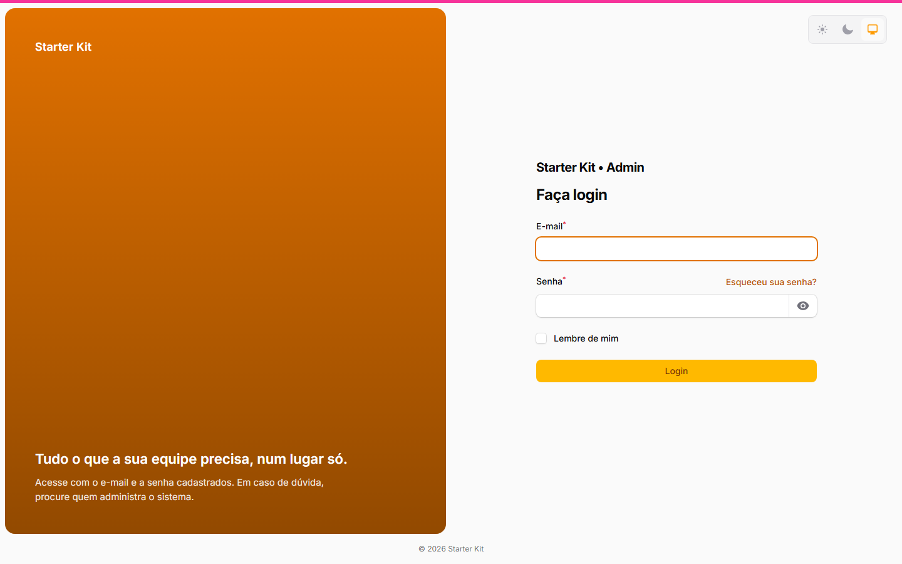
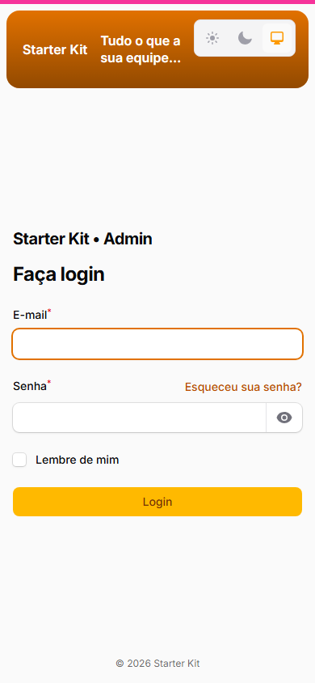
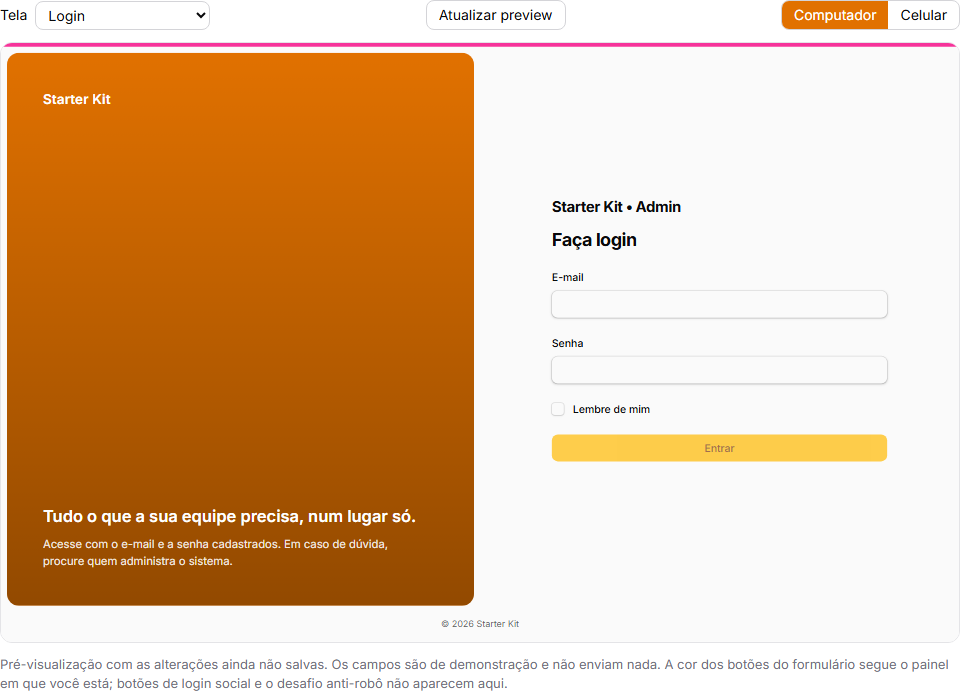

The kit's authentication screens — login, registration, password request and reset, e-mail
confirmation, two-factor challenge and session lock — have **two layouts**, and whoever administers
the application picks one in **Configurações da aplicação › Telas de acesso** (application settings › sign-in screens)
(`/admin/configuracoes-da-aplicacao?tab=telas-de-acesso`), looking at a preview that follows every
change before saving. With organizations on, each organization can use the default appearance or
have its own.

Nothing changes by itself: while nobody picks another layout, the screens stay exactly as they
always were — including in projects that update the kit.

## The two layouts

| Layout | What it looks like | When to use it |
|---|---|---|
| **Classic** (the default) | The artwork takes most of the screen (70%) and the form sits beside it: on the right on the login, on the left on the other screens. Below 1024 px wide the artwork disappears and the form takes the screen | Whoever already uses the kit and wants no change at all; whoever prefers the large artwork |
| **Brand panel** | The screen splits in half: one half holds the form, the other a rounded panel with your brand — color or artwork background, the logo on a light badge and two optional sentences. On phones the panel **does not disappear**: it becomes a short strip above the form, with the logo and the headline | Whoever wants an entrance with identity, a message and the same look on phones |

The chosen layout applies to **all** authentication screens of the three panels (`/admin`, `/app`,
`/infra`) and to the single pages `/login`, `/cadastro` and `/esqueci-minha-senha`, when the single
login page is on.

| Brand panel (desktop) | Brand panel (phone) |
|---|---|
|  |  |

## Brand panel options

| Option | What it does | Default |
|---|---|---|
| **Form side** | Left or right; the panel goes to the other side | Right |
| **Panel background** | **Color** or **Identity artwork** — the same artwork as the Identity tab (or the artwork generated with the application name, when none was uploaded). A dark veil goes over the artwork, so the text stays readable | Color |
| **Panel color** | A color in `#RRGGBB` format. Blank means the primary color — the organization's, when the screen belongs to an organization with its own color. With a light color, the panel text turns dark, so it stays readable | Blank |
| **Headline** | Up to 80 characters, plain text. Shown on the panel, always smaller than the form title | Empty |
| **Supporting text** | Up to 160 characters, plain text. Hidden on phones, so the strip stays short | Empty |
| **Logo on the panel** | The identity logo (or the organization's) on a light badge, which works on any background color. With no logo uploaded, the application name is shown | On |
| **Theme switcher** | The light/dark/system selector in the corner of the screen | On |

Text is always treated as text: no field accepts HTML, CSS or script, and repeated or edge spaces
are removed. A color outside the format, a text above the limit or an option outside the list is
rejected with an error on the field itself, and nothing is saved.

## The preview

The **Pré-visualização** (preview) section shows the screen with the changes **not saved yet**:

- pick the screen (login, password request or registration) and the width (desktop or phone) — the frame has the size of a real screen (1440×900 or 390×844), scaled down to fit;
- the preview refreshes by itself when a field changes; the **Atualizar preview** (refresh preview) button forces it;
- the preview fields are for show: they do not sign in, do not send e-mail and do not lead to a
  social provider.

Three limits, also written on the screen itself:

1. The preview runs inside `/admin`, so the **form buttons** come out with the admin panel color. The
   brand panel does come out with the right color — the organization's included.
2. Social login buttons and the anti-robot challenge **do not show** in the preview; on the real
   screen they stay where they always were.
3. The theme switcher is **off** in the preview: it stores the preference in the browser, and
   clicking it there would switch the theme of the settings screen itself.

The preview only opens for whoever gets into `/admin` and can save that scope — the default appearance requires the settings
screen permission; an organization's, the permission to edit (or create) organizations — and only
with the person's own draft. A preview address copied to someone else, or opened after 30 minutes
without use, answers 404.

## Per organization

With organizations on, each organization's form (`/admin/organizacoes/{id}/edit`, by default)
gains the **Telas de acesso** (sign-in screens) section, with the **Usar a aparência padrão** (use the default appearance) switch:

- **on** (the default): the organization follows the appearance set in Settings — future changes
  included;
- **off**: the organization gets its own. The editor starts with a **copy** of the default and, from
  then on, it **no longer follows** changes to the default. Same preview, with the organization's
  color and logo.

Turning the switch back on discards the organization's own appearance; turning it off later starts
from a fresh copy of the current default.

The organization can pick the classic even when the default is the brand panel (and vice versa).

### On which screen the organization's appearance applies

The appearance only identifies the organization where that is safe and possible; everywhere else,
the default applies:

| Screen | Organization considered | Without it |
|---|---|---|
| `/app` login and `/login` | the one in the URL's `?org={slug}`, if **active** | default |
| `/app` registration and `/cadastro` | the open registration's (`?org=`) or the invitation's | default |
| Session lock in `/app` | the organization the person was in | default |
| Password request and reset, e-mail confirmation, two factors | none | default |
| Any `/admin` and `/infra` screen | none | default |
| Any screen, with organizations off | none | default |

Once the organization is found, its own appearance applies — if it has one; otherwise, the default.

- **Login**: with `?org={slug}` in the URL (`/app/login?org=acme`, or `/login?org=acme` with the
  single page), of an **active** organization — it does not need to accept open registration. The
  appearance stays the same after a wrong password.
- **Registration**: the organization's open registration (`?org=`) and accepting an organization's
  invitation.
- **Session lock**: the organization the person was in.
- **Password request and reset, e-mail confirmation, two factors**: always the default — those
  screens cannot safely tell which organization the person belongs to.

The appearance is only appearance: it **never** decides who gets in. That is still each panel's
access rule.

## Updating a project that already uses the kit

- `php artisan kit:update` delivers the classes, views and CSS; run `php artisan migrate` (one
  settings migration and a new `tenants` column, both empty) and `php artisan filament:assets`.
- After that the screens stay **identical**: the stored value starts empty, and empty is the classic.
- Switching layouts is always a decision of whoever administers, on the screen.

Whoever hand-customized the providers' `AuthDesignerPlugin` block keeps that configuration on the
classic: the classic layout uses exactly what the providers build. The brand panel reuses the
artwork and switcher the providers configured, and decides the rest by itself (half the screen, side,
no blur).

## How it works inside

For whoever is going to extend the kit:

- `App\Support\AparenciaDasTelasDeAcesso` is the decider: it reads the appearance (the
  installation's, or the organization's falling back to the installation's), reduces any stored value
  to the vocabulary — an unknown value never breaks the login screen, it falls back to the classic
  with a warning in the `autenticacao` log — and applies the layout over the configuration the
  providers give `caresome/filament-auth-designer`.
- Every kit authentication page uses the `App\Filament\Concerns\VesteAparenciaDasTelas` trait and
  overrides `getAuthDesignerConfig()` in one line. A new authentication page does the same — and, like
  every authentication page, redeclares `$layout`.
- The brand panel is rendered by the view `resources/views/filament/auth/painel-de-marca.blade.php`,
  called by the package's `media` partial, which the kit already overrides. The package layout is
  **not** published: the screen structure, the footer and the authentication-screen detection stay the
  same.
- The style lives in `resources/css/filament/kit.css`, scoped to `.kit-painel-de-marca` — the classic
  does not have that class and is not reached.
- The installation's appearance lives in `ConfiguracoesDoKit::$aparencia_das_telas`
  (`config('kit.identidade.aparencia_das_telas')`); the organization's, in the JSON column
  `tenants.aparencia_das_telas`. Empty = classic for the installation and "use the default" for the
  organization.
- The preview is the page `App\Filament\Pages\Auth\PreviewDasTelasDeAcesso`, at the route
  `/admin/preview-das-telas-de-acesso`, with the draft kept in cache for 30 minutes under a key of the
  user's own.

### Why not a separate package

The customization depends on pieces that belong to the kit — the application settings, the
organizations, the identity and the permissions —, and `kit:update` delivers kit files but does not
install new packages. A package would require a manual `composer require` in every project and an
adapter for each of those pieces. That is why the customization lives in the kit, on top of the auth
designer, without modifying it.
