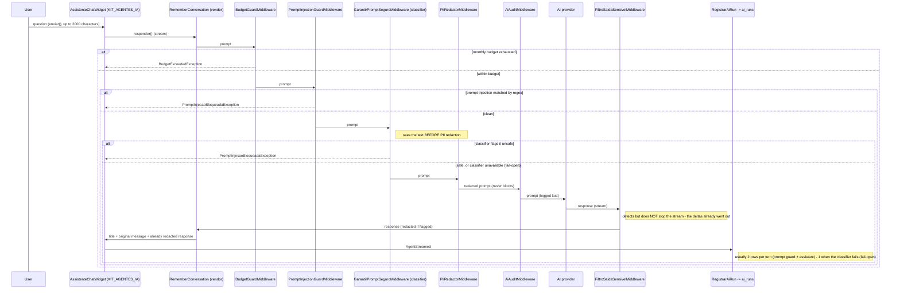

Everything the kit delivers, numbered, with **where it is**, **who can access it** and **how to check it**. It serves three purposes: knowing what already exists before reimplementing, having a manual test script after a `kit:update`, and giving names to features in the automated tests.

**The "Test" column** says what is already checked automatically:

| Mark | Meaning |
|---|---|
| 🟢 | covered by automated test — `composer test:kit` or `composer test:browser` |
| 🔵 | covered **in a real browser**, with JS running |
| ⚪ | no test: depends on an external service (worker, cron, Docker, SMTP) or on visual judgment |

**The "Origin" column** says where the feature comes from: **package** (the package delivers it, and the kit only registers or configures it), **own code** (the core is the kit's) or **package with own customization** (the package provides the core, and the kit changes its behaviour). The package is named by its Composer or npm name, the same one used in the [installed packages reference](../../referencia/pacotes-instalados/).

Numbering only grows: a new feature gets the next free number, and the number of a feature that leaves stays in the table, marked as removed and with the reason. The tables follow the order of the themes, not that of the numbers.

Where the route has `{org}`, it is multi-tenant mode — without it, the path is `/app` directly.

## Access and authentication

| # | Feature | Origin | Where | Who can access | How to check | Test |
|---|---|---|---|---|---|---|
| F-01 | Login on the three panels | package with own customization: `filament/filament`, `caresome/filament-auth-designer` | `/app/login`, `/admin/login`, `/infra/login` | anyone | the three screens open without authentication, in the two-column layout | 🔵 |
| F-02 | Password recovery | package with own customization: `filament/filament`, `caresome/filament-auth-designer` | `/{panel}/password-reset/request` | anyone | the screen opens; the e-mail depends on `MAIL_MAILER` | 🔵 |
| F-03 | [Registration by invitation](../../autenticacao/convites/) | own code | `/app/register?token=…` | whoever has a valid token | without a token in the query, the screen refuses and goes to login (with `KIT_REGISTRO=false`, the default) | 🟢 |
| F-03a | [Open sign-up](../../autenticacao/registro-aberto/) (opt-in) | own code | `/app/register` | anyone, with `KIT_REGISTRO=true` | the form shows up; whoever signs up gets **only** `panel_user` and hits 403 on `/admin` and `/infra` | 🟢 |
| F-03b | [Sign-up approval](../../autenticacao/registro-aberto/) (opt-in) | own code | users screen → *Approve* action | whoever can edit users | with `KIT_REGISTRO_APROVACAO_MANUAL=true` the account is born pending and enters no panel at all | 🟢 |
| F-03c | [E-mail verification](../../autenticacao/registro-aberto/) (opt-in) | package with own customization: `filament/filament`, `caresome/filament-auth-designer` | `/app/email-verification/prompt` | authenticated, with the requirement on (in the UI or in `.env`) | the route always exists — a kit middleware decides, per request; invited users are never blocked | 🟢 |
| F-04 | Two-factor authentication | package with own customization: `jeffgreco13/filament-breezy` | `/{panel}/two-factor-authentication` | authenticated | the screen opens and offers the QR | 🔵 |
| F-05 | Passkeys | package: `jeffgreco13/filament-breezy` | — | — | disabled in the kit: Breezy is born with `$passkeys = false`, and no panel calls `enablePasskeys()` | ⚪ |
| F-06 | Session lock | package with own customization: `marjose123/filament-lockscreen` | user menu → *Lock session* | authenticated | locks without logging out, from the menu or on its own after 30 min without browsing (`LOCKSCREEN_IDLE_TIMEOUT`); returns with the password **or** with social login (the same buttons as the login screen). Uses the login layout, not `SimplePage` | 🟢 |
| F-07 | My profile, avatar and password | package with own customization: `jeffgreco13/filament-breezy` | `/{panel}/meu-perfil` | authenticated | edits name, e-mail, password and avatar | 🔵 |
| F-08 | Impersonate | package with own customization: `stechstudio/filament-impersonate` | `/admin/users` → row action | `master_global` | enters as another user and returns via the top banner | ⚪ |
| F-72 | **[Social login per panel](../../autenticacao/login-social/)** | package with own customization: `laravel/socialite` | buttons below the login form of the three panels; `/auth/{provedor}/redirect` and `/auth/{provedor}/callback` | anyone, with the provider enabled on the panel | Google, GitHub, LinkedIn and X ship off and are enabled one by one, per panel, at `/admin/configuracoes-da-aplicacao` (Login tab) or in `.env`; the button only shows up with complete credentials, and an e-mail the provider has not verified is refused | 🔵 |
| F-73 | **[Single login page](../../autenticacao/login-unificado/)** | own code | `/login` and, for whoever can reach more than one panel, `/login/painel` | anyone, with `KIT_LOGIN_UNIFICADO=true` | off by default; once on, `/admin/login`, `/infra/login` and `/app/login` lead to `/login`, whoever reaches one panel goes straight in and whoever reaches more than one picks from a card screen. Sign-up and password recovery move to `/cadastro` and `/esqueci-minha-senha` | 🔵 |
| F-74 | **[Anti-robot protection](../../autenticacao/protecao-anti-robo/)** | package with own customization: `ddr/filament-captcha` | login, password recovery and registration screens of the three panels | anyone, with `KIT_ANTI_ROBO=true` and both provider keys | reCAPTCHA v2 or v3, Turnstile or hCaptcha, picked at `/admin/configuracoes-da-aplicacao` (Login tab); it ships off, and without both keys it stays off. It fails closed: a provider outage refuses the submission. In a local environment the challenge stays off, unless `KIT_ANTI_ROBO_LOCAL=true` | 🔵 |
| F-75 | **[Sign-in screen appearance](../../autenticacao/aparencia-das-telas/)** | package with own customization: `caresome/filament-auth-designer` | `/admin/configuracoes-da-aplicacao` (Telas de acesso tab) and the preview at `/admin/preview-das-telas-de-acesso` | whoever has `View:ConfiguracoesDoKit` | swap the classic layout for the brand panel (side, width, colour, gradient or artwork, logo and two sentences) and check it in the preview before saving; login, sign-up and password recovery can each have their own appearance. An installation that updates keeps identical screens until someone chooses | 🔵 |
| F-76 | **["+" in the sign-up e-mail](../../autenticacao/registro-aberto/)** | own code | `/admin/configuracoes-da-aplicacao` (Registro tab) or `KIT_EMAIL_PERMITIR_MAIS` | whoever signs up, is invited or changes the e-mail | allowed by default; once off, a "+" before the "@" is refused, with a single message, on open sign-up, on the invitation for a new account, on the users screen of `/admin` and `/app`, on the social login that would create an account and on the profile e-mail change. An account that already has a "+" keeps signing in | 🟢 |
| F-77 | **[Active, inactive and deleted account](../../autenticacao/estados-de-usuario/)** | own code | `/admin/users` (row actions) and the notice at `/conta-indisponivel` | whoever has `Desativar:User` or `Reativar:User` | an inactive account passes the password or the social login, but lands on the notice, with no session; deletion is logical, and the account comes back from the `/admin` list or from the `/infra` recycle bin (F-59). Nobody deactivates their own account or the last active `master_global`, and an unavailable account cannot be impersonated | 🟢 |
| F-116 | **[Set the password by e-mail, on the profile](../../autenticacao/login-social/)** | own code | `/admin/meu-perfil`, `/app/meu-perfil` and `/infra/meu-perfil` | authenticated | the block sends Filament's reset link to the account e-mail and ends the session — for whoever signed in through social login and never had a password, or forgot the current one. Without it, changing the password, turning on 2FA and unlocking the session would require the current password | 🟢 |

## Authorization

| # | Feature | Origin | Where | Who can access | How to check | Test |
|---|---|---|---|---|---|---|
| F-09 | **The role decides the panel** (`roles.painel`) | package with own customization: `bezhansalleh/filament-shield` | `/admin` → Roles | `admin`, `master_global` | create a role with panel `infra`: whoever has it enters `/infra` and takes 403 on `/admin` | 🟢 |
| F-10 | Readable 403 on the wrong panel | package with own customization: `anselmokossa/filament-sentinel` | any panel | — | the 403 screen tells the account, the roles and offers an exit — and **does not** reveal permission in production | 🔵 |
| F-11 | `master_global` wins by `Gate::before` | own code | the three | `master_global` | they enter everything **without** any permission in the database | 🟢 |
| F-12 | Roles and permissions grouped by panel | package with own customization: `bezhansalleh/filament-shield` | `/admin/shield/roles` | `admin` | the screen separates *Panel /admin*, */app* and */infra* | 🟢 |
| F-13 | `panel_user` **does not** administer | own code | `/app{/org}` → sidebar | `panel_user` | they use the business and don't see Users or Invitations — their matrix is the panel's **minus** the admin screens | 🟢 |
| F-14 | Without a role, nobody enters | own code | the three | — | authenticated user without a role takes 403 on the three. Null **is not** a wildcard | 🟢 |
| F-62 | **Every screen in the panel has its own permission, and it is enforced** | package with own customization: `bezhansalleh/filament-shield` | `/admin/shield/roles` → *Pages* and *Widgets* tabs | `admin` | uncheck `View:Pulse` on the `infra` role: the screen answers 403 and the menu item is gone. Holds for the kit's 7 Pages and 24 Widgets **and** for the 7 screens that come from packages in `/infra` — except the three from the Command Center, see F-67 | 🟢 |
| F-63 | **Every action and every link in the kit has its own permission** | package with own customization: `bezhansalleh/filament-shield` | `/admin/shield/roles` → *Resources* and *Custom* tabs | `admin` | uncheck `Reenviar:Convite`: the *Resend* button leaves the invitations listing. The RelationManager ones (attach, detach, assign roles) likewise | 🟢 |
| F-64 | [A new action or link **does not** ship open by forgetfulness](../../operacao/depois-de-criar-resources/) | own code | `tests/Kit/PermissoesDeAcoesTest.php` | — | add an `Action::make('x')` under `app/Filament/` and run the suite: the inventory case turns red naming the file | 🟢 |
| F-65 | **[Welcome page at the root](../../autenticacao/rota-publica/)**, with what the installation customised | package with own customization: `harvirsidhu/filament-cards` | `/` | anonymous | open it unauthenticated: the three cards and the config show up, and no secrets — the test plants a sentinel in 8 values and asserts its absence | 🟢 |
| F-66 | [The root inherits the project theme and colour](../../autenticacao/rota-publica/) | own code | `/` | anonymous | change `KIT_COR_PRIMARIA`, run `npm run build` and reload: the button changes colour. Without the route's `panel:app` it would render amber | 🟢 |
| F-67 | The three exceptions are **declared**, not hidden | package with own customization: `ssbityukov/filament-command-center` | `/infra/command-center/commands` | `infra` | uncheck `View:Commands`: the screen **still** opens. The package exposes a single callback for all three of its Pages, so their barrier is `command-center:access`. `tests/Kit/PermissoesDeTelasTest.php` has the case that asserts this gap and turns red the day it closes | 🔵 |
| F-68 | **[Card navigation hub](../../recursos/hub-de-navegacao/)** | package with own customization: `harvirsidhu/filament-cards` | `/infra/hub-de-infraestrutura` (always); `/admin/hub-de-administracao` and `/app{/org}/hub-do-negocio` with `KIT_HUB=true` | whoever enters the panel | open the `/infra` hub: a grid of cards, one per destination your role can reach. With `KIT_HUB=false` the `/admin` and `/app` hubs leave the menu and the ⌘K search, and the URL answers 403 | 🟢 |
| F-120 | **Role escalation locks** | own code | `/admin/users` (create and edit), the invitations and `/admin/shield/roles` | `admin`, `master_global` | only someone who already is `master_global` grants `master_global`, and anyone else grants only roles of panels they reach; a role out of reach that the person already holds stays on the record page and saving does not revoke it. The reserved name is refused when creating or renaming a role | 🟢 |

## Invitations

| # | Feature | Origin | Where | Who can access | How to check | Test |
|---|---|---|---|---|---|---|
| F-15 | [Individual invitation](../../autenticacao/convites/) | own code | `/admin/convites` · `/app/{org}/convites` | `admin`, `admin_app` | e-mail + role + organization; the link goes by e-mail with a single-use token | 🟢 |
| F-16 | Invitation for someone who **already has an account** | own code | same place | same | it becomes an *access offer*: the person logs in with the password they already have and is linked | 🟢 |
| F-17 | Received invitations box | own code | user menu → *Received invitations* | whoever has `View:ConvitesRecebidos`, with multi-tenancy on | accept **or decline**; the decline is recorded. Without multi-tenancy the screen does not open, and the e-mail link remains the way to accept | 🟢 |
| F-18 | Bulk invitation | own code | listing header | `admin`, `admin_app` | paste N addresses; one with a problem **does not** bring down the others, and the summary says why | 🟢 |
| F-19 | Automatic reminders | own code | `kit:convites-lembrar` (cron 08:00) | — | D+3 and D+5, with a **second parallel link**; the original keeps working | 🟢 |
| F-20 | Resend / revoke | own code | row action | `admin` | resend **kills** the previous links; revoke deletes and goes to `/infra/audits` | 🟢 |

## Multi-tenancy (opt-in)

| # | Feature | Origin | Where | Who can access | How to check | Test |
|---|---|---|---|---|---|---|
| F-21 | [Turn the mode on](../../recursos/multi-tenancy/) | own code | `php artisan kit:tenancy` | — | runs `migrate:fresh --seed`; **requires a clean git tree** | ⚪ |
| F-22 | Panel by organization | package with own customization: `filament/filament` | `/app/{org}` | linked | the selector lists only the user's organizations; another one gives 404 | 🟢 |
| F-23 | Organization CRUD | own code | `/admin/organizacoes` | `admin` | create, **view** and edit in full screen | 🔵 |
| F-24 | User linking | own code | organization → *Linked users* | `admin` | link, unlink and give a role **in that** organization | 🟢 |
| F-25 | `admin_app` | own code | `/app/{org}/users` and `/app/{org}/convites` | the role | administers **one** organization: users and invitations scoped. Does not enter `/admin` | 🟢 |
| F-26 | [Scope by trait](../../recursos/multi-tenancy/) | own code | your models | — | `BelongsToTenant` gives relationship, global scope and filling — the scope covers every query in a panel request with an open organization (widget, listener), and not only the Resources; in a job, command or seeder no organization is open, and the query goes back to global | 🟢 |
| F-27 | **Visual identity: color** | own code | organization → *Visual identity* | `admin` | choose the color and open `/app/{org}`: the whole panel wears its color, and `/admin` **does not** change | 🔵 |
| F-28 | **Visual identity: logo** | package with own customization: `caresome/filament-auth-designer` | same | `admin` | the logo appears on the `/app` lock screen instead of the base image | 🔵 |
| F-69 | **The `/app` record page does not tell where else the person is** | own code | `/app{/org}/users/{id}` | `admin_app` | open a colleague's record page: it shows the account and **omits** the organizations and roles that the `/admin` one shows. Listing them there would tell whoever administers one organization that the account also belongs to another — the query scope guarantees you only see people FROM the current organization, not that you may see where else they are. The absence lives in `App\Filament\Concerns\FichaDeUsuario` | 🟢 |
| F-78 | **[Sign-up per organization](../../autenticacao/registro-aberto/)** | own code | `/app/register?org={slug}`, or `/cadastro?org={slug}` with the single login page | anyone, with `KIT_REGISTRO=true` and the organization accepting public sign-up | each organization opts in with *Aceita cadastro público*, on its form in `/admin` (default: off); without `?org`, with an unknown slug, an inactive organization or sign-up off for it, the refusal is the same. The login screen shows the *Cadastre-se* link only with a target organization | 🟢 |
| F-87 | **[Link to each organization's panel](../../recursos/multi-tenancy/)** | own code | `/admin/organizacoes` — list, view and edit | whoever opens the organizations screen | the list carries the *Painel* column with the address in plain sight, opening in a new tab; the address comes from the panel's URL generator and follows the slug. The link navigates and does not authorize: without an `/app` role the answer is 403, and without a link to the organization, 404 | 🟢 |
| F-88 | **[Selector hidden with a single organization](../../recursos/multi-tenancy/)** | own code | top of the `/app/{org}` sidebar; the switch, at `/admin/configuracoes-da-aplicacao` (Aplicação tab) | whoever has access to a single active organization | with the switch on (`KIT_TENANCY_OCULTAR_SELETOR_UNICO`, off by default), the selector disappears for whoever has only one organization; with two or more, it stays. Hiding it changes no access | 🟢 |
| F-89 | **[Each organization's login screen](../../recursos/multi-tenancy/)** | own code | `/app/login?org={slug}`, or `/login?org={slug}` with the single page; and the sign-up and session lock of the organization | anyone | on the organization form, turn off *Usar a aparência padrão* and pick the classic layout or the brand panel, with its own colour and logo; it applies to the login and sign-up with `?org=`, to the invitation of the organization and to the session lock. An unknown slug, an inactive organization and the `/admin` and `/infra` screens keep the default appearance | 🟢 |
| F-90 | **[Organization insights](../../recursos/multi-tenancy/)** | package with own customization: `laboiteacode/filament-dashboard-widgets`, `gsferro/filament-stat-plus-easy` | `/admin/organizacoes` (list and record page) | `admin` | above the table, the overview with totals and active organizations; below it, unique users per organization, sign-ins per panel and the timeline of changes. The record page shows linked users, active users, activation rate and recent sign-ins. Only successful logins count, and a deleted person stays out | 🟢 |
| F-91 | **[Organization label](../../recursos/multi-tenancy/)** | own code | `/admin/configuracoes-da-aplicacao` (Aplicação tab), or `KIT_TENANCY_LABEL` and `KIT_TENANCY_LABEL_PLURAL` | whoever has `View:ConfiguracoesDoKit` | swap "Organização" for Empresa, Cliente, Escola or whatever the business uses: with multi-tenancy, the selector, the screens and the root page switch to the label, and the code keeps `Tenant` | 🟢 |
| F-92 | **Role badge of the open organization** | own code | `/app/{org}` → user menu | linked users | whoever has different roles in each organization (`panel_user` in one, `admin_app` in another) sees the badge follow the switch; without a role in the open organization, there is no badge | 🟢 |

## Administration

| # | Feature | Origin | Where | Who can access | How to check | Test |
|---|---|---|---|---|---|---|
| F-29 | Users | own code | `/admin/users` | `admin` | create, **view** and edit in full screen, with a **mandatory** role on creation. The record page shows account, status, origin, dates and — only here — the person's organizations and roles | 🟢 |
| F-30 | AI agent catalog | package with own customization: `laravel/ai` | `/admin/agentes-ia` | `admin`, with `KIT_AGENTES_IA=true` | prompt, provider, model, tools and guardrails are **data**, editable without deploy. With AI usage off (the factory default, F-84), the screen leaves the menu and the URL answers 404 | 🟢 |
| F-31 | [Onboarding authoring](../../recursos/tutorial-guiado/) | package with own customization: `wallacemartinss/filament-onboarding` | `/admin/onboarding-flows` | `admin` | checklists and tours; consumption happens on all three panels (F-94). With the tutorial off (the factory default), the screen leaves the menu and the URL answers 404 | 🔵 |
| F-32 | Filled dashboard | package with own customization: `gsferro/filament-stat-plus-easy`, `laboiteacode/filament-dashboard-widgets`, `leandrocfe/filament-apex-charts`, `flowframe/laravel-trend` | `/admin` | `admin` | 9 widgets: the kit's 7 over the data the panel already has and Filament's 2 built-in ones (account and info) | 🔵 |
| F-79 | **[Application settings](../../recursos/configuracoes-do-kit/)** | package with own customization: `spatie/laravel-settings`, `filament/spatie-laravel-settings-plugin` | `/admin/configuracoes-da-aplicacao` | whoever has `View:ConfiguracoesDoKit` (`admin`) | seven tabs — Identidade, E-mail, Tabelas, Registro, Login, Telas de acesso and Aplicação —, saved in the database, which beats `.env` from the next request on, with no deploy; every change lands in `/infra/audits`, with the e-mail password masked | 🔵 |
| F-80 | **[Free colour, logo per theme and panel header](../../recursos/configuracoes-do-kit/)** | own code | `/admin/configuracoes-da-aplicacao` (Identidade tab) | whoever has `View:ConfiguracoesDoKit` | the primary colour takes a free hexadecimal value, which beats the palette name; the logo can be a single one or one per theme, and the browser swaps it with the theme; the header picks what the top of the three panels shows. Inside `/app/{org}`, the organization identity wins (F-27, F-28) | 🔵 |
| F-119 | **[E-mail delivery configured on screen](../../recursos/configuracoes-do-kit/)** | own code | `/admin/configuracoes-da-aplicacao` (E-mail tab) | whoever has `View:ConfiguracoesDoKit` | transport (`log`, `array`, `smtp`), server, port, encryption, user, password and sender apply to every message from the next request on; the password is stored encrypted and enters the `/infra/audits` trail masked | 🟢 |

## Infrastructure

| # | Feature | Origin | Where | Who can access | How to check | Test |
|---|---|---|---|---|---|---|
| F-33 | Health checks | package with own customization: `shuvroroy/filament-spatie-laravel-health` | `/infra/health-check-results` | `infra` | database, cache, queues, scheduler, debug mode, environment, optimized app, disk (outside Windows) and local AI. **Opens empty until `php artisan health:check` runs** | 🔵 |
| F-34 | Backups | package with own customization: `spatie/laravel-backup`, `brimham/filament-backup-monitor` | `/infra/backup-runs` | `infra` | history and health per destination | 🔵 |
| F-35 | Queues | package with own customization: `croustibat/filament-jobs-monitor` | `/infra/queue-monitors` | `infra` | pending, failed and history — of any driver | 🔵 |
| F-36 | Logs | package with own customization: `laboiteacode/filament-logs-explorer` | `/infra/logs` | `infra` (`ver-logs`) | reading and searching by channel. **No delete button**: a trail is evidence | 🔵 |
| F-37 | Change auditing | package with own customization: `owen-it/laravel-auditing`, `tapp/filament-auditing` | `/infra/audits` | `infra` | who changed what, field by field | 🔵 |
| F-38 | Access trail | package with own customization: `tapp/filament-authentication-log` | `/infra/authentication-logs` | `infra` | logins, IP and device | 🔵 |
| F-39 | Command center | package with own customization: `ssbityukov/filament-command-center` | `/infra/command-center/commands` | `infra` (`command-center:access`) | **pre-approved** commands in `config/command-center.php`, with history | 🔵 |
| F-40 | Pulse | package with own customization: `laravel/pulse`, `dotswan/filament-laravel-pulse` | `/infra/pulse` | `infra` | real-time performance. Needs `pulse:check` to have data | 🔵 |
| F-41 | Dependency graph | package with own customization: `laboiteacode/filament-dependency-graph` | `/infra/dependency-graph` | `infra` | map of models, relations, resources and panels | 🔵 |
| F-42 | Composer releases | package with own customization: `mominalzaraa/filament-composer-release-notifier` | `/infra/composer-release-packages` | `infra` | warns of new version. **Informational — never updates anything.** Sync is a job: without worker, the screen is empty | 🔵 |
| F-43 | AI runs | package with own customization: `fomvasss/laravel-ai-tasks` | `/infra/execucoes-ia` | `infra` (`ver-ai-tasks`) | ledger with cost and tokens per run | 🔵 |
| F-44 | Clear caches | package with own customization: `cms-multi/filament-clear-cache` | `/infra` topbar | `infra` | `cache`, `config` and `view` together, plus `modelCache` with `MODEL_CACHE_ENABLED=true` | ⚪ |
| F-57 | [Grouped exceptions](../../recursos/trilhas-de-infraestrutura/) | package with own customization: `bezhansalleh/filament-exceptions` | `/infra/exceptions` | `infra` | by type and frequency, with a menu badge. Retention (`KIT_RETENCAO_EXCECOES_DIAS`) only happens **with the scheduler running** | 🟢 |
| F-58 | [Mail trail](../../recursos/trilhas-de-infraestrutura/) | package with own customization: `tapp/filament-maillog` | `/infra/mail-logs` | `infra` | every e-mail sent. It stores the **body** — including the invitation's acceptance link | 🟢 |
| F-59 | [Recycle bin](../../recursos/trilhas-de-infraestrutura/) | package with own customization: `promethys/revive` | `/infra/recycle-bin` | `infra` | restores what was deleted with `SoftDeletes`. Lists **only** the models declared in `models()` in `InfraPanelProvider` | 🟢 |
| F-85 | **Filled `/infra` dashboard** | package with own customization: `gsferro/filament-stat-plus-easy`, `laboiteacode/filament-dashboard-widgets`, `leandrocfe/filament-apex-charts` | `/infra` | `infra` | 19 widgets: the kit's 17 — health, queues, backups, packages, AI, sign-ins and auditing — and Filament's 2 built-in ones; the numbers add up every organization, and each widget checks its own permission (F-62) | 🔵 |

## Productivity and UI

| # | Feature | Origin | Where | Who can access | How to check | Test |
|---|---|---|---|---|---|---|
| F-45 | [⌘K search](../../referencia/busca-e-idioma/) | package with own customization: `wezlo/filament-search-spotlight` | topbar of the three | authenticated | records, screens, pages and "Create X" actions — **all scoped by permission** | 🔵 |
| F-46 | Animated count badges | package with own customization: `gsferro/filament-odometer-easy`, `gsferro/odometer-easy` | sidebar | authenticated | the count comes from `getEloquentQuery()`; zero doesn't become a badge | 🟢 |
| F-47 | Notification center | package: `prodstarter/filament-notification-center` | bell | authenticated | tabs and categories; it updates by 30 s polling. With `BROADCAST_CONNECTION=reverb` the kit turns polling off, but it does not configure Filament's Echo, so the bell only updates on a page reload | ⚪ |
| F-48 | Panel switch | package with own customization: `bezhansalleh/filament-panel-switch` | user menu | whoever accesses more than one | goes straight to the chosen panel | 🔵 |
| F-49 | **Light/dark theme** | package: `filament/filament`, `caresome/filament-auth-designer` | top switch | anyone | screens follow `prefers-color-scheme` and the switch; choice persists | 🔵 |
| F-50 | Resizable columns | package with own customization: `asmit/resized-column` | any table | authenticated | width adjustable on any table, remembered in the session on the kit's 7 listings that use `HasResizableColumn` | ⚪ |
| F-51 | Environment indicator | package: `pxlrbt/filament-environment-indicator` | topbar | anyone | `local`/`staging` badge; hides in production | 🔵 |
| F-52 | Branded error pages | package: `anselmokossa/filament-sentinel` | 403, 404, 419, 500, 503 | — | with the panel's look, in Portuguese (pt-BR) | 🔵 |
| F-60 | **[Language switcher](../../referencia/busca-e-idioma/)** | package with own customization: `bezhansalleh/filament-language-switch`, `laravel-lang/common` | topbar of the three and login screens | anyone | only shows up with **two** locales in `kit.idiomas`; translates Filament and the packages, **not** the kit's labels | 🟢 |
| F-61 | **[Attachments and media](../../recursos/anexos-e-midia/)** | package with own customization: `filament/spatie-laravel-media-library-plugin`, `solution-forest/filament-simplelightbox` | Projects form and table | whoever reaches the resource, which only exists with multi-tenancy and `KIT_DEMO=true` | upload, `anexos` collection, `miniatura` conversion and a table lightbox. The attachment inherits the record's own organization scope | 🟢 |
| F-70 | **Rich header on the record screens** | package with own customization: `mortalkiller/filament-page-header` | view and edit user (`/admin` and `/app`) and organization (`/admin`) | whoever reaches the screen | in place of Filament's plain text title: avatar (or the initials, when there is no photo), name, status badge and copyable metadata. It comes from `mortalkiller/filament-page-header`; the content is the same in both panels, in `App\Filament\Concerns\CabecalhoDeUsuario`, because what an account **is** does not change per panel | 🟢 |
| F-71 | **Initials avatar drawn in here** | own code | every avatar without a photo, in the three panels | anyone | open any screen and watch the network tab: no request leaves the application. Filament's default provider is `UiAvatarsProvider`, which made **every** person's browser request `ui-avatars.com` on every screen load — carrying the initials in the query string and the panel's `Referer` along. `App\Support\AvatarDeIniciais` returns an inline SVG, with the same looks | 🟢 |
| F-81 | **[Footer with signature and system version](../../recursos/configuracoes-do-kit/)** | own code | footer of the three panels and of the authentication screens | the signature, anyone; the version, only whoever signed in | the `©` with the year and the application name shows up for everyone, login included; your system version (*Versão do sistema* field, seeded by `APP_VERSION`) and the kit one, behind its switch, only for whoever signed in — showing the version on the login screen would hand out the list of vulnerabilities of the installation | 🔵 |
| F-82 | **[Unsaved-changes warning](../../recursos/configuracoes-do-kit/)** | package: `filament/filament` | forms of the three panels | authenticated | leave a changed form and the screen asks for confirmation before discarding; the switch sits at `/admin/configuracoes-da-aplicacao` (`KIT_ALERTA_ALTERACOES_NAO_SALVAS`, on by default) | 🔵 |
| F-83 | **[Layout density and each person's appearance](../../recursos/configuracoes-do-kit/)** | own code | `/admin/configuracoes-da-aplicacao` (Aplicação tab) and everyone's *Meu perfil* | authenticated; the personal choice, with `KIT_APARENCIA_POR_USUARIO` on | comfortable, compact or dense tighten the cards, tables, menu and buttons of the three panels at once, on the next F5 and with no build; each person can pick density, font, colour and menu mode, and inside an organization the personal choice only applies if the organization allows it | 🔵 |
| F-86 | **[Dynamic dashboard](../../recursos/configuracoes-do-kit/)** | package with own customization: `mddev31/filament-dynamic-dashboard` | `/admin/dashboard-dinamico`, `/app/dashboard-dinamico` and `/infra/dashboard-dinamico` | whoever enters the panel; building the grid requires `Manage:Dashboard` | with `KIT_DASHBOARD_DINAMICO=true` (off by default), the entry screen becomes a grid the person builds, moves and resizes; turning it off deletes no grid. With multi-tenancy, each organization has its own, and a new organization starts with the default grid | 🔵 |
| F-93 | **[Shortcut dock](../../recursos/dock-de-atalhos/)** | package with own customization: `hoceineel/filament-quick-action-dock` | floating button on the panels ticked at `/admin/configuracoes-da-aplicacao` (Aplicação tab) or in `KIT_DOCK_PAINEIS` | whoever has `Usar:Dock` | off by default, with no panel ticked; up to 10 favourites per person, from any panel, managed in a slideover. Hidden on the lock screen and on the login screens | 🔵 |
| F-94 | **[Guided tutorial](../../recursos/tutorial-guiado/)** | package with own customization: `wallacemartinss/filament-onboarding` | `/admin/onboarding`, `/app/onboarding` and `/infra/onboarding` (*Primeiros passos*), with the floating checklist | whoever has `View:PrimeirosPassos` | off by default (`KIT_ONBOARDING=false`); seeding (`OnboardingSeeder` or `kit:install --onboarding`) creates the journeys, and the switch at `/admin/configuracoes-da-aplicacao` turns on the checklist, the tours and the page. Off, the tutorial screens answer 404 | 🔵 |
| F-95 | **[Saved table views](../../recursos/visoes-de-tabela-e-carregamento/)** | package with own customization: `sehsah/filament-remember-table` | *Visões* button on the kit's listings, on the three panels | authenticated; saving requires `Usar:VisoesDeTabela` | off by default (`KIT_TABELA_VISOES_SALVAS`); once on in the Tabelas tab, they save filters, search, sort, grouping and columns under a name, per user and per organization, with a default view, optional sharing and `?view=` in the URL | 🟢 |
| F-96 | **[Continuous table loading](../../recursos/visoes-de-tabela-e-carregamento/)** | package with own customization: `asignua/filament-infinite-scroll` | every table of the three panels | authenticated | it starts on pagination; in the Tabelas tab of `/admin/configuracoes-da-aplicacao` (`KIT_TABELA_CARREGAMENTO`), switch to infinite scroll or to the *Carregar mais* button, one block the size of "rows per page" at a time | 🔵 |
| F-97 | **[CSV import and export](../../recursos/import-export-csv/)** | package with own customization: `filament/filament` | header of the listings of AI agents (`/admin/agentes-ia`), Organizations (`/admin/organizacoes`, export only), AI runs (`/infra/execucoes-ia`, export only) and Projects (`/app/{org}/projetos`) | whoever has `Import:{Model}` or `Export:{Model}` | the import respects the organization boundary, and the export neutralizes formulas in every column; both are jobs, and without a worker nothing comes out. In Users and Invitations the Action ships commented out, ready to turn on | 🔵 |
| F-98 | **[Global table, modal and toggle defaults](../../recursos/configuracao-global-filament/)** | own code | every table, modal, toggle and column of the three panels, plugin screens included | authenticated | striped table, stacked on mobile, with the user's cut kept in the session, reorderable and stickable columns and 10 rows per page; a modal that does not close on Esc. Seven of these defaults are editable in the Tabelas tab of `/admin/configuracoes-da-aplicacao` | 🟢 |
| F-99 | **100% pt-BR UI, plugins included** | package with own customization: `laravel-lang/common` | the three panels and the login screens | anyone | `APP_LOCALE=pt_BR` in `.env.example`; Laravel's translations ship published in `lang/pt_BR`, Filament brings its own, and the kit wrote the ones for plugins that ship English only in `lang/vendor/` | ⚪ |
| F-100 | **[Media on a private disk, served by signed URL](../../recursos/anexos-e-midia/)** | package with own customization: `filament/spatie-laravel-media-library-plugin` | the Projects attachments and `php artisan kit:midia-privada` | whoever reaches the resource; the command, whoever operates the server | the media disk ships private (`MEDIA_DISK=local`) and a file only opens through a signed URL — the same URL without a signature is refused; `kit:midia-privada` moves to the private disk what was already stored on a public disk, and `--dry-run` only reports | 🟢 |
| F-101 | **[10 MB upload cap and SVG refused](../../recursos/configuracoes-do-kit/)** | own code | every file field of the three panels | authenticated | the factory cap is 10 MB (`KIT_UPLOAD_MAXIMO_MB`), aligned with the Livewire temporary upload, and a file above it is refused on the form, in megabytes; SVG is refused because XML accepts `<script>` | 🟢 |
| F-118 | **"Back to top" button** | own code | every screen of the three panels, plugin screens included | anyone | the button shows up after 400 px of scrolling and moves above the assistant chat when the chat is on screen, without overlapping | 🟢 |

## AI

| # | Feature | Origin | Where | Who can access | How to check | Test |
|---|---|---|---|---|---|---|
| F-53 | Assistant chat | package with own customization: `laravel/ai` | corner of **every** screen on the panels listed in `KIT_AGENTES_IA_PAINEIS` (none by default) | authenticated, with `KIT_AGENTES_IA=true` (F-84) | streaming; renders empty without user | ⚪ |
| F-54 | Chained guardrails | package with own customization: `laravel/ai`, `fomvasss/laravel-ai-tasks` | — | — | budget, prompt injection, local classifier, PII redaction and sensitive-output filter. **Fail-closed** at assembly: an agent without guardrails does not start. The local classifier is fail-open (when it is down, the chat goes on with the other layers), and the output filter detects without stopping the stream — see the sequence below | 🟢 |
| F-55 | Run ledger | package with own customization: `fomvasss/laravel-ai-tasks` | `/infra/execucoes-ia` | `infra` | every call becomes a row with cost and tokens | 🟢 |
| F-56 | Local inference | package with own customization: `laravel/ai` | `docker compose --profile ai up -d` | — | llama.cpp; or switch `AI_PROVIDER` to SaaS | ⚪ |
| F-84 | **[AI switch and chat panels](../../recursos/configuracoes-do-kit/)** | own code | `/admin/configuracoes-da-aplicacao` (Aplicação tab), or `KIT_AGENTES_IA` and `KIT_AGENTES_IA_PAINEIS` | whoever has `View:ConfiguracoesDoKit` | off by default: the agent catalog (F-30) leaves the menu and answers 404, and the chat (F-53) shows up on no panel; once on, the list picks the panels where the chat shows up, and an empty list means none | 🟢 |

### Assistant sequence, from prompt to ledger

The widget works in two phases: `enviar()` validates the question (up to 2000 characters,
`app/Livewire/AssistenteChatWidget.php:Validate:47`) and stores it as pending; `responder()` streams
through the agent. The SDK wraps the pipeline with `RememberConversation` **before** `middleware()`
runs, because `Assistente` uses `RemembersConversations`
(`vendor/laravel/ai/src/Providers/Concerns/GeneratesText.php:RemembersConversations:148`); inside
it, the order comes from the `agentes_ia.guardrails` catalog, resolved by `GuardrailRegistry::MAPA`
(`app/Ai/Guardrails/GuardrailRegistry.php:MAPA:23-27`) and seeded by
`database/seeders/AssistenteSeeder.php:guardrails:39`, with `BudgetGuardMiddleware` first
(`app/Ai/Agents/AgenteBase.php:middleware:66`) and `AiAuditMiddleware` last
(`app/Ai/Agents/Assistente.php:middleware:61`).

The ledger comes from an event listener, never a direct call:
`Event::listen([AgentPrompted::class, AgentStreamed::class], RegistrarAiRun::class)`
(`app/Providers/KitServiceProvider.php:AgentStreamed:524`), and `RegistrarAiRun::handle()` writes to
`ai_runs` with `status: 'ok'` (`app/Ai/Listeners/RegistrarAiRun.php:AiRun::create:44`) — a request
blocked by any layer above **never** reaches this row. The widget exists on the panels the settings
screen picks, mounted by a global render hook
(`app/Providers/Concerns/ConfiguraFilamentGlobal.php:configuraChatDoAssistente:184`) decided by
`App\Support\AgentesDeIa` on every request — and only with AI agents usage on (`KIT_AGENTES_IA`).

## Installation and operations

| # | Feature | Origin | Where | Who can access | How to check | Test |
|---|---|---|---|---|---|---|
| F-102 | **[Installer that asks five things](../../comecar/instalacao-avancada/)** | own code | `php artisan kit:install`, called by `composer create-project` | whoever installs | project name, database (SQLite, PostgreSQL or MySQL), admin e-mail and password, primary colour and multi-organization; pressing Enter on everything installs with the defaults, and without a terminal nothing is asked. At the end, the summary of what changed and the offer to run the kit's tests | 🟢 |
| F-103 | **[Administrator change from the command line](../../comecar/instalacao-avancada/)** | own code | `php artisan kit:admin` | whoever operates the server | changes the `master_global` e-mail and password, with confirmation; refuses an e-mail that already belongs to another account and stops when there is more than one administrator, instead of guessing which | 🟢 |
| F-104 | **[How the project is customized](../../comecar/instalacao-avancada/)** | own code | `php artisan kit:info` | whoever operates the server | shows the name, the colour and the other choices of the installation, and where each value comes from — the database beats the configuration file; with multi-tenancy, it lists the organizations | 🟢 |
| F-105 | **[Update from a new kit version](../../comecar/atualizando-o-projeto/)** | own code | `php artisan kit:update` | whoever maintains the project | compares the project version with a new kit tag only on the paths that belong to the kit — your business code never enters the comparison — and applies file by file, with your approval; `--dry-run` only shows what changed | 🟢 |
| F-106 | **[Local domain by name](../../comecar/dominio-local/)** | own code | offered at the end of `php artisan kit:install` | whoever installs | instead of IP and port, `http://meu-projeto.test`: the installer suggests the domain from the project name, writes the line to the `hosts` file (asking for elevation on Windows) and adjusts `APP_URL`. It is opt-in, and no versioned file changes | 🟢 |
| F-107 | **[Docker containers per profile](../../comecar/instalacao-avancada/)** | own code | `docker-compose.yml` | whoever operates the environment | `docker compose up -d` brings up PostgreSQL with pgvector and Redis; the `ai` profile adds llama.cpp, `mail` Mailpit, `app` the containerized application with nginx, worker, scheduler, Reverb and Pulse, `realtime` only Reverb and Pulse, and `full` llama.cpp and Mailpit together; MySQL comes up by the service name | ⚪ |
| F-108 | **[Stack update on the container host](../../operacao/deploy-docker-multiambiente/)** | own code | `./deploy_docker_local.sh` | whoever operates the container host | `git pull`, image rebuild after the pull, `--profile app up -d`, migrations, `optimize:clear`, health check on `/up` and the Reverb probe; `--recreate` recreates the containers when `.env` changed | 🟢 |
| F-109 | **[Several environments on one server](../../operacao/deploy-docker-multiambiente/)** | own code | `docker/traefik/docker-compose.override.yml`, copied to the root of the checkout | whoever operates the server | dev, test and staging of the same project, each with its own containers, database and volumes, behind a Traefik that routes by hostname; without the override nothing changes, and trusted proxies only apply with `TRUSTED_PROXIES` in `.env` | 🟢 |
| F-110 | **[Optional model caching](../../referencia/pacotes-instalados/)** | package with own customization: `mike-bronner/laravel-model-caching` | the models with a Resource on `/app` — `User`, `Convite` and `Projeto` | — | off by default (`MODEL_CACHE_ENABLED=false`); once on, with `MODEL_CACHE_STORE=model-cache`, a repeated query comes from Redis, and `save`, `update` and `delete` clear the model cache. `/admin` and `/infra` stay uncached, and the clear-caches button (F-44) starts including `modelCache` | 🟢 |
| F-117 | **[Clean addresses with the DocumentRoot at the root](../../recursos/configuracao-global-filament/)** | own code | every request, through a global middleware | — | on hosting that rewrites everything into the `public` folder without pointing the `DocumentRoot` at it, Laravel would generate addresses with that segment; the kit detects the rewrite in the root `.htaccess` and removes the segment, leaving a correct installation untouched. `KIT_URL_REMOVER_SUFIXO_PUBLIC=true` forces it (nginx), and `false` turns it off | 🟢 |
| F-121 | **Strong passwords and destructive commands blocked in production** | own code | every password rule and `php artisan`, with `APP_ENV=production` | — | in production, a password needs 12 characters, with upper and lower case, a number and a symbol, and is refused when it shows up in a known leak; `migrate:fresh` and the other destructive database commands are blocked. Outside production, a password asks for 8 characters | ⚪ |

## Development

| # | Feature | Origin | Where | Who can access | How to check | Test |
|---|---|---|---|---|---|---|
| F-111 | **[DTOs with Laravel Data](../../recursos/dto-com-laravel-data/)** | package with own customization: `spatie/laravel-data` | `app/Data/` | whoever develops on the kit | structured data crossing a class boundary travels as a typed object; an executable guard fails a Data class without the package inheritance, a credential inside a DTO and API consumption or responses without one | 🟢 |
| F-112 | **[Quality gates](../../referencia/qualidade-de-codigo/)** | package with own customization: `larastan/larastan`, `laravel/pint`, `laraveldaily/filacheck`, `happenv-com/filament-phpstan-macros`, `rector/rector`, `driftingly/rector-laravel`, `pestphp/pest`, `pestphp/pest-plugin-laravel`, `pestphp/pest-plugin-phpstan`, `pestphp/pest-plugin-mutate`, `phpunit/phpunit`, `brianium/paratest`, `mockery/mockery`, `fakerphp/faker`, `icanhazstring/composer-unused`, `maglnet/composer-require-checker` | `composer test`, `composer test:kit`, `composer test:coverage` and the CI workflow | whoever develops on the kit | `composer test` runs Pint, PHPStan at level 8, FilaCheck and the suites; CI repeats Pint, PHPStan and the suites in parallel, runs the browser screens and measures coverage with a 78 % floor, and `deps:check` comes out there as a report that fails nothing. Rector and mutation run on demand | 🟢 |
| F-113 | **[README images generated by tests](../../referencia/qualidade-de-codigo/)** | package with own customization: `pestphp/pest-plugin-browser`, `playwright` | `composer art` and `php artisan kit:arte` | whoever develops on the kit | the browser tests capture the screens, and `kit:arte` assembles the frames and the animated clips; every declared frame has a capture behind it, and an incomplete clip is reported without bringing down the others | 🟢 |
| F-114 | **[Ready for coding agents](../../operacao/agentes-de-ia/)** | package with own customization: `laravel/boost`, `laravel/pao` | `.ai/rules/`, `.claude/agents/` and the kit skills | whoever develops with an agent | Boost delivers the MCP server and the guidelines; the kit's rules, per path, tell the agent what applies in each folder; the skills and the sub-agents arrive through `kit:update`; and `laravel/pao` switches the test and analysis output to JSON only when an agent runs them | 🟢 |
| F-115 | **[Kit conventions](../../operacao/convencoes-do-kit/)** | own code | the models and the routes of the three panels | whoever develops on the kit | UUID in the routes and an integer `id` as primary key, through the `TemUuid` trait — a URL with a numeric id returns 404; immutable dates; plugin translations in `lang/vendor/`; and the other rules of the page | 🟢 |

## What the roadmap **does not** cover on its own

Some features depend on something outside the process, and no test replaces it:

| Feature | Depends on | Without this |
|---|---|---|
| F-57, F-58 (trail retention) | the scheduler (`schedule:work`) | the exceptions and mail tables grow with no ceiling; the deadline in `config/kit.php` stays merely declared |
| F-15…F-20 (e-mail delivery) | a real `MAIL_MAILER` **and** a worker (`QUEUE_CONNECTION=database`) | the invitation is saved and the queue fills; nothing leaves |
| F-33 (health checks) | a run of `php artisan health:check` | the screen opens **empty**, with no state explaining — the dashboard widget warns, the resource page doesn't |
| F-35, F-42 (queues and releases) | a worker | the Composer sync job stays in the queue: F-42 shows "no records" and F-35 counts pending against an empty table |
| F-97 (import and export) | a worker | the file is accepted and the row lands in `imports` or `exports`, but the completion notification never arrives |
| F-19 (reminders) | the scheduler (`schedule:work`) | the command is never called |
| F-34 (backups) | destination configured in `config/backup.php` | the screen opens empty |
| F-40 (Pulse) | `pulse:check` running | the screen opens with no data |
| F-53, F-56 (AI) | llama.cpp or an API key | the assistant answers unavailable |

`composer dev` brings up server, queue, Vite and Reverb together in development, which already covers e-mail delivery (the second item on the list).

Trail retention (first item) and health checks (third item) still depend on the **scheduler**
(`schedule:work`), which `composer dev` does **not** start — run it separately, or bring up the
compose `scheduler` service.

