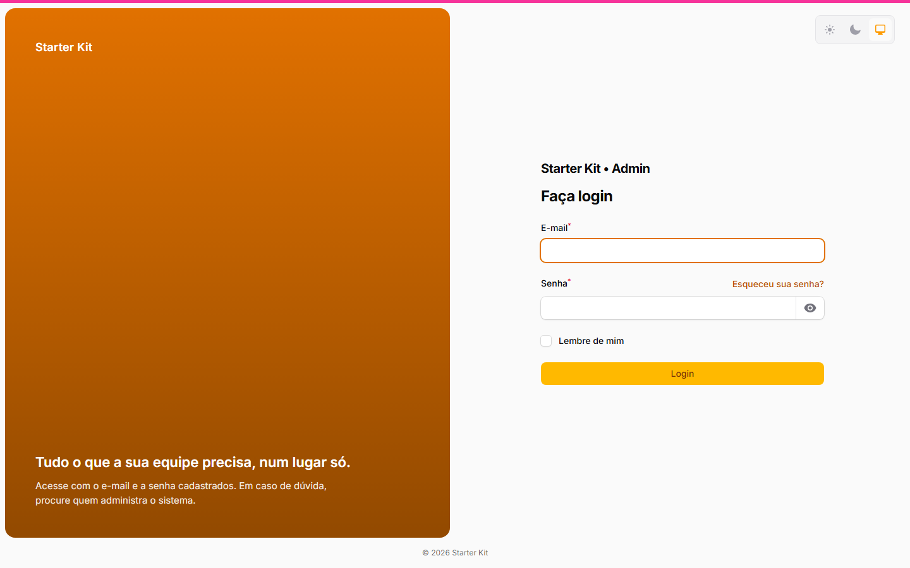
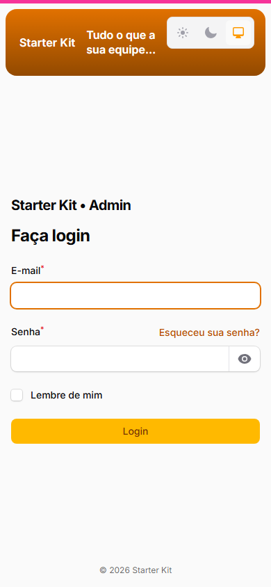
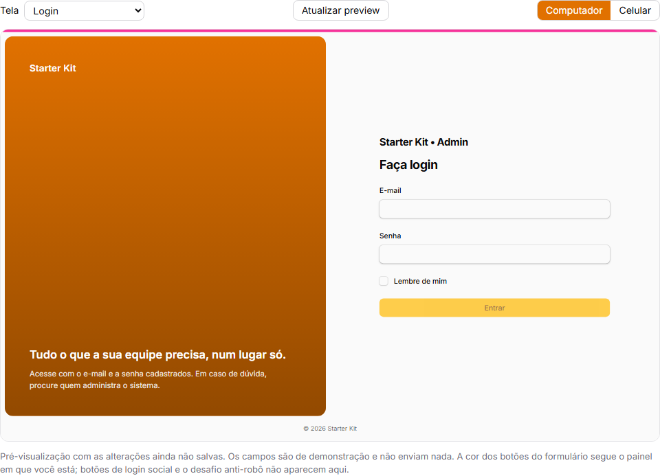

As telas de autenticação do kit — login, cadastro, recuperação e redefinição de senha, confirmação
de e-mail, desafio de dois fatores e bloqueio de sessão — têm **dois layouts**, e quem administra a
aplicação escolhe qual usar em **Configurações da aplicação › Telas de acesso**
(`/admin/configuracoes-da-aplicacao?tab=telas-de-acesso`), olhando um preview que acompanha cada
mudança antes de salvar. Com organizações ligadas, cada organização pode usar a aparência padrão ou
ter a sua.

Nada muda sozinho: enquanto ninguém escolher outro layout, as telas continuam exatamente como sempre
foram — inclusive em projetos que atualizam o kit.

## Os dois layouts

| Layout | Como fica | Quando usar |
|---|---|---|
| **Clássico** (o padrão) | A arte ocupa a maior parte da tela (70%) e o formulário fica ao lado: à direita no login, à esquerda nas demais telas. Abaixo de 1024 px de largura a arte some e o formulário ocupa a tela | Quem já usa o kit e não quer mudança nenhuma; quem prefere a arte grande |
| **Painel de marca** | A tela se divide ao meio: numa metade o formulário, na outra um painel arredondado com a sua marca — cor ou arte de fundo, a logo num selo claro e duas frases opcionais. No celular o painel **não some**: vira uma faixa curta acima do formulário, com a logo e a frase de destaque | Quem quer uma entrada com identidade, mensagem e a mesma cara no celular |

O layout escolhido vale para as telas de autenticação vestidas pelo Auth Designer nos três painéis — login, cadastro, recuperação e redefinição de senha, confirmação de e-mail, dois fatores e bloqueio de sessão; a escolha de painel, que aparece depois de entrar, continua como está — (`/admin`, `/app`,
`/infra`) e para as páginas únicas `/login`, `/cadastro` e `/esqueci-minha-senha`, quando a página
única de login está ligada.

| Painel de marca (computador) | Painel de marca (celular) |
|---|---|
|  |  |

## As opções do painel de marca

| Opção | O que faz | Padrão |
|---|---|---|
| **Lado do formulário** | Esquerda ou direita; o painel fica do outro lado | Direita |
| **Fundo do painel** | **Cor** ou **Arte da identidade** — a mesma arte da aba Identidade (ou a arte gerada com o nome da aplicação, quando nenhuma foi enviada). Sobre a arte vai um véu escuro, para o texto continuar legível | Cor |
| **Cor do painel** | Uma cor no formato `#RRGGBB`. Em branco, a cor primária — a da organização, quando a tela é de uma organização com cor própria. Com uma cor clara, o texto do painel passa a escuro, para continuar legível | Em branco |
| **Frase de destaque** | Até 80 caracteres, texto puro. Sai no painel, sempre menor que o título do formulário | Vazia |
| **Texto de apoio** | Até 160 caracteres, texto puro. Some no celular, para a faixa continuar curta | Vazio |
| **Logo no painel** | A logo da identidade (ou a da organização) num selo claro, que funciona com qualquer cor de fundo. Sem logo enviada, aparece o nome da aplicação | Ligado |
| **Alternador de tema** | O seletor claro/escuro/sistema no canto da tela | Ligado |

O texto é sempre tratado como texto: nenhum campo aceita HTML, CSS ou script, e espaços repetidos ou
nas bordas são removidos. Uma cor fora do formato, um texto acima do teto ou uma opção fora da lista
são recusados com erro no próprio campo, e nada é salvo.

## O preview

A seção **Pré-visualização** mostra a tela com as alterações **ainda não salvas**:

- escolha a tela (login, recuperar senha ou cadastro) e a largura (computador ou celular) — o quadro tem o tamanho de uma tela de verdade (1440×900 ou 390×844), reduzido para caber;
- o preview se atualiza sozinho quando um campo muda; o botão **Atualizar preview** força a
  atualização;
- os campos do preview são de demonstração: não fazem login, não enviam e-mail e não levam a
  provedor social.

Três limites, escritos também na própria tela:

1. O preview roda dentro do `/admin`, então os **botões do formulário** saem com a cor do painel
   admin. O painel de marca, esse sim, sai com a cor certa — inclusive a da organização.
2. Botões de login social e o desafio anti-robô **não aparecem** no preview; na tela de verdade eles
   continuam onde sempre estiveram.
3. O alternador de tema fica **desligado** no preview: ele grava a preferência no navegador, e
   clicar nele ali trocaria o tema da própria tela de configurações.

O preview só abre para quem entra no `/admin` e pode salvar aquele escopo — a aparência padrão exige a permissão da tela
de configurações; a de uma organização, a de editar (ou criar) organizações — e só com o rascunho da
própria pessoa. Endereço de preview copiado para outra pessoa, ou aberto depois de 30 minutos sem uso,
responde 404.

## Por organização

Com organizações ligadas, o formulário de cada organização
(`/admin/organizacoes/{id}/edit`, por padrão) ganha a seção **Telas de acesso**, com o interruptor **Usar a
aparência padrão**:

- **ligado** (o padrão): a organização acompanha a aparência definida em Configurações — inclusive as
  mudanças futuras;
- **desligado**: a organização passa a ter a sua. O editor começa com uma **cópia** da padrão e, a
  partir daí, ela **não acompanha** mais as mudanças da padrão. O mesmo preview, com a cor e a logo
  da organização.

Ligar o interruptor de novo descarta a aparência própria; desligá-lo depois começa de uma cópia nova
da padrão vigente.

A organização pode escolher o clássico mesmo com a padrão em painel de marca (e vice-versa).

### Em que tela a aparência da organização vale

A aparência só identifica a organização onde isso é seguro e possível; no resto, vale a padrão:

| Tela | Organização considerada | Sem ela |
|---|---|---|
| Login do `/app` e `/login` | a do `?org={slug}` da URL, se estiver **ativa** | padrão |
| Cadastro do `/app` e `/cadastro` | a do cadastro aberto (`?org=`) ou a do convite | padrão |
| Bloqueio de sessão no `/app` | a organização em que a pessoa estava | padrão |
| Recuperar e redefinir senha, confirmar e-mail, dois fatores | nenhuma | padrão |
| Qualquer tela do `/admin` e do `/infra` | nenhuma | padrão |
| Qualquer tela, com organizações desligadas | nenhuma | padrão |

Encontrada a organização, vale a aparência própria dela — se ela tiver uma; senão, a padrão.

- **Login**: com `?org={slug}` na URL (`/app/login?org=acme`, ou `/login?org=acme` com a página
  única), de uma organização **ativa** — ela não precisa aceitar cadastro aberto. A aparência
  continua a mesma depois de uma senha errada.
- **Cadastro**: o cadastro aberto da organização (`?org=`) e o aceite de convite de uma organização.
- **Bloqueio de sessão**: a organização em que a pessoa estava.
- **Recuperar e redefinir senha, confirmar e-mail, dois fatores**: sempre a padrão — essas telas não
  sabem com segurança de qual organização a pessoa é.

A aparência é só aparência: ela **nunca** decide quem entra. Quem decide continua sendo a regra de
acesso de cada painel.

## Atualizando um projeto que já usa o kit

- `php artisan kit:update` entrega as classes, as views e o CSS; rode `php artisan migrate` (uma
  migration de configurações e uma coluna nova em `tenants`, as duas vazias) e
  `php artisan filament:assets`.
- Depois disso as telas continuam **idênticas**: o valor gravado nasce vazio, e vazio é o clássico.
- A troca de layout é sempre uma decisão de quem administra, na tela.

Quem personalizou à mão o bloco `AuthDesignerPlugin` dos providers continua com a sua configuração no
clássico: o layout clássico usa exatamente o que os providers montam. O painel de marca usa a arte
da aba Identidade (não a mídia do provider) e o alternador que os providers configuraram, e decide sozinho
o resto (metade da tela, lado, sem desfoque).

## Como funciona por dentro

Para quem vai estender o kit:

- `App\Support\AparenciaDasTelasDeAcesso` é o decisor: lê a aparência (da instalação, ou da
  organização com queda para a da instalação), reduz qualquer valor gravado ao vocabulário — um valor
  desconhecido nunca derruba a tela de login, volta ao clássico com um aviso no log `autenticacao` —
  e aplica o layout sobre a configuração que os providers dão ao `caresome/filament-auth-designer`.
- Toda página de autenticação do kit usa o trait `App\Filament\Concerns\VesteAparenciaDasTelas` e
  sobrescreve `getAuthDesignerConfig()` numa linha. Página nova de autenticação faz o mesmo — e, como
  toda página de autenticação, redeclara `$layout`.
- O painel de marca é renderizado pela view `resources/views/filament/auth/painel-de-marca.blade.php`,
  chamada pelo partial `media` do pacote que o kit já sobrescreve. O layout do pacote **não** é
  publicado: a estrutura da tela, o rodapé e a detecção de tela de autenticação continuam os mesmos.
- O estilo está em `resources/css/filament/kit.css`, escopado em `.kit-painel-de-marca` — o
  clássico não tem essa classe e não é alcançado.
- A aparência da instalação mora em `ConfiguracoesDoKit::$aparencia_das_telas`
  (`config('kit.identidade.aparencia_das_telas')`); a da organização, na coluna JSON
  `tenants.aparencia_das_telas`. Vazio = clássico na instalação e "usa a padrão" na organização.
- O preview é a página `App\Filament\Pages\Auth\PreviewDasTelasDeAcesso`, na rota
  `/admin/preview-das-telas-de-acesso`, com o rascunho guardado no cache por 30 minutos numa chave do
  próprio usuário.

### Por que não um pacote separado

A personalização depende de peças que são do kit — as configurações da aplicação, as organizações, a
identidade e as permissões —, e o `kit:update` entrega arquivos do kit mas não instala pacotes novos.
Um pacote exigiria um `composer require` manual em todo projeto e um adaptador para cada uma dessas
peças. Por isso a personalização mora no kit, sobre o auth designer, sem modificá-lo.
