As telas de autenticação do kit — login, cadastro, recuperação e redefinição de senha, confirmação
de e-mail, desafio de dois fatores e bloqueio de sessão — têm **dois layouts**, e quem administra a
aplicação escolhe qual usar em **Configurações da aplicação › Telas de acesso**
(`/admin/configuracoes-da-aplicacao?tab=telas-de-acesso`), olhando um preview que acompanha cada
mudança antes de salvar. Com organizações ligadas, cada organização pode usar a aparência padrão ou
ter a sua.

Nada muda sozinho: enquanto ninguém escolher outro layout, as telas continuam exatamente como sempre
foram — inclusive em projetos que atualizam o kit.

## Veja as possibilidades

Cada quadro abaixo é a mesma tela de login com uma combinação diferente de opções — tudo feito na tela de configurações, sem código.

Clique numa imagem para vê-la em tamanho real.

|  |  |  |
|---|---|---|
| [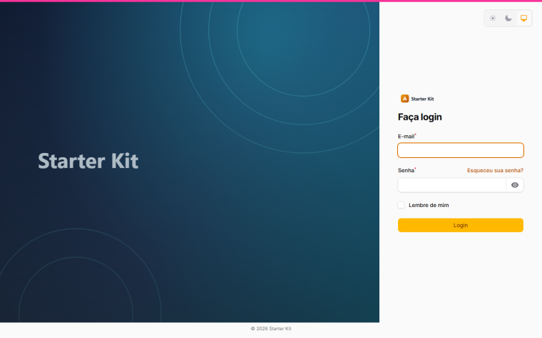](https://raw.githubusercontent.com/gsferro/filament-starter-kit-easy/main/art/telas-de-acesso-classico.png) | [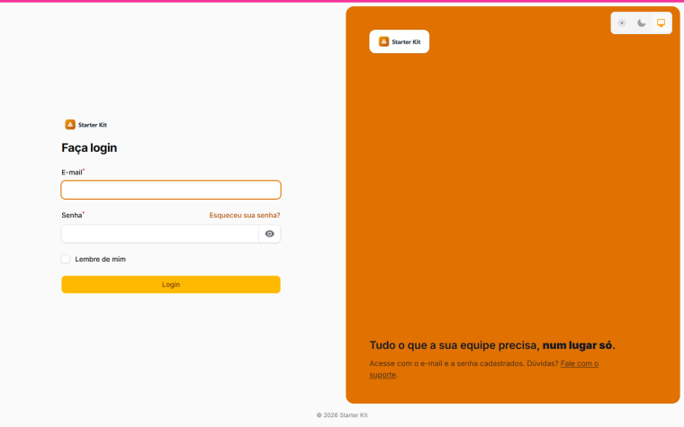](https://raw.githubusercontent.com/gsferro/filament-starter-kit-easy/main/art/telas-de-acesso-cor-primaria.png) | [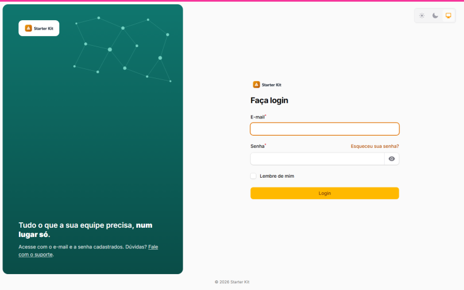](https://raw.githubusercontent.com/gsferro/filament-starter-kit-easy/main/art/telas-de-acesso-cor-propria.png) |
| *Clássico (o padrão de sempre)* | *Painel na cor primária do Filament* | *Cor própria, formulário à direita, painel de 40% e rede parada* |
| [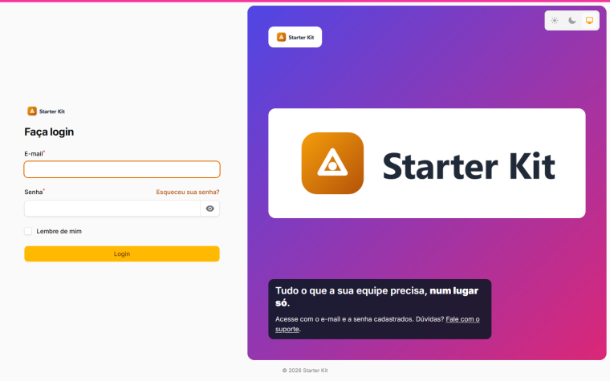](https://raw.githubusercontent.com/gsferro/filament-starter-kit-easy/main/art/telas-de-acesso-gradiente-diagonal.png) | [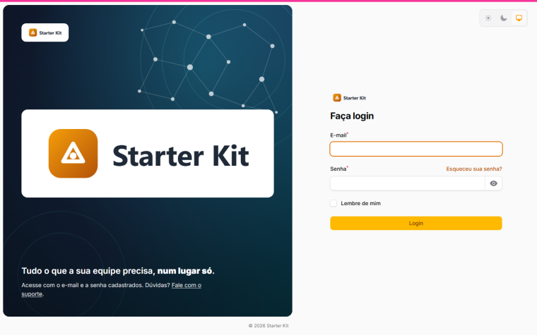](https://raw.githubusercontent.com/gsferro/filament-starter-kit-easy/main/art/telas-de-acesso-arte-e-rede.png) | [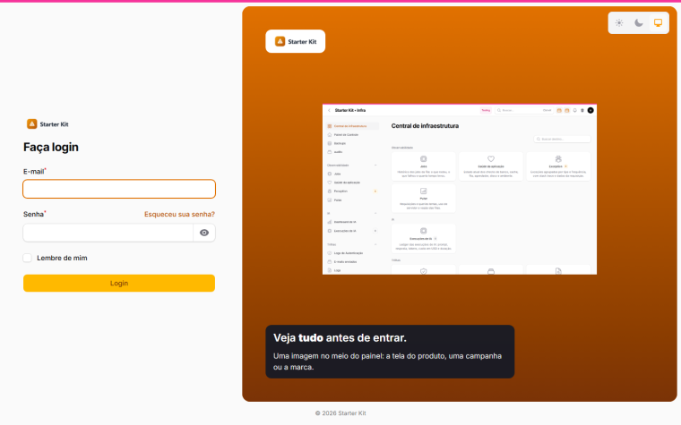](https://raw.githubusercontent.com/gsferro/filament-starter-kit-easy/main/art/telas-de-acesso-imagem-no-meio.png) |
| *Gradiente diagonal com a logo grande no meio* | *Arte de fundo, logo no meio e rede de pontos* | *Imagem sua no meio do painel, gradiente vertical* |
| [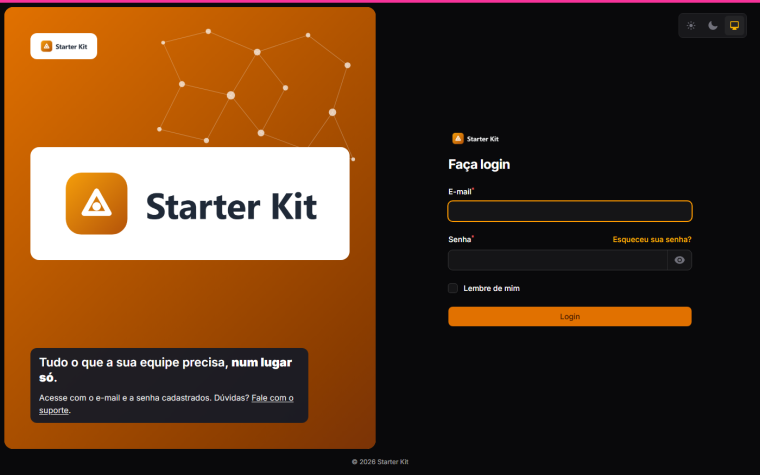](https://raw.githubusercontent.com/gsferro/filament-starter-kit-easy/main/art/telas-de-acesso-tema-escuro.png) | [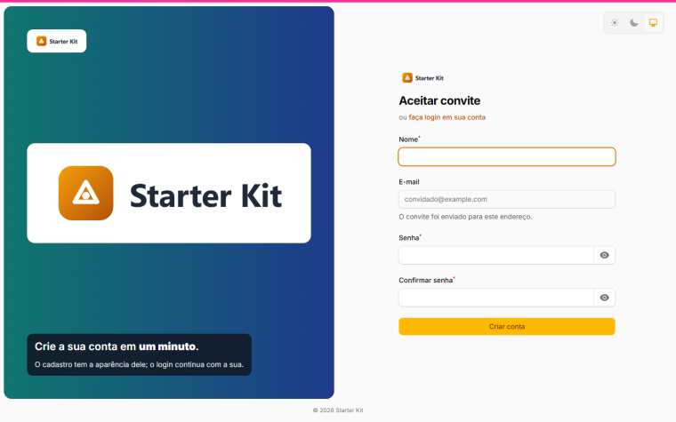](https://raw.githubusercontent.com/gsferro/filament-starter-kit-easy/main/art/telas-de-acesso-cadastro-propria.png) | [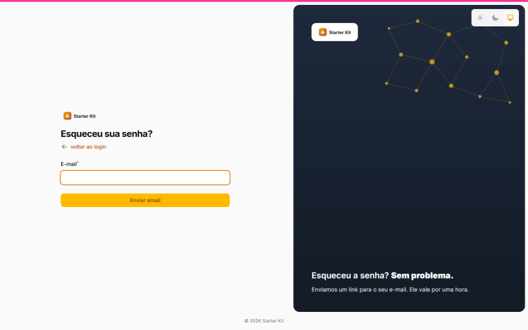](https://raw.githubusercontent.com/gsferro/filament-starter-kit-easy/main/art/telas-de-acesso-esqueci-propria.png) |
| *Tema escuro, com a logo escura* | *Cadastro com aparência própria* | *"Esqueci a senha" com aparência própria* |

| No celular, com a logo | No celular, sem logo (nome da aplicação) |
|---|---|
| [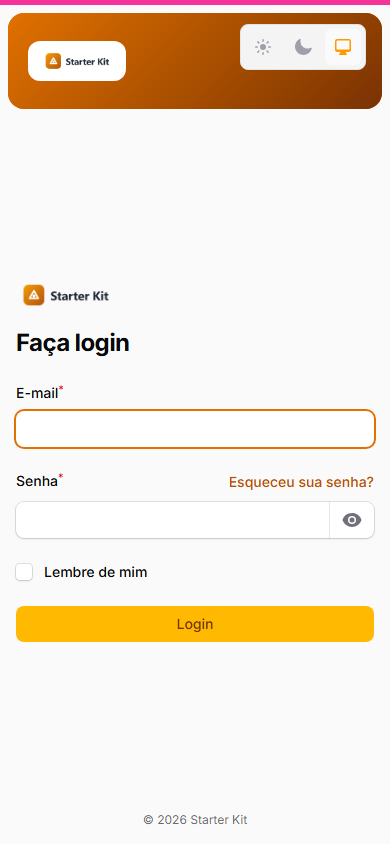](https://raw.githubusercontent.com/gsferro/filament-starter-kit-easy/main/art/telas-de-acesso-celular-logo.png) | [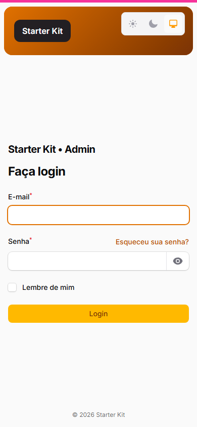](https://raw.githubusercontent.com/gsferro/filament-starter-kit-easy/main/art/telas-de-acesso-celular-nome.png) |

## Os dois layouts

| Layout | Como fica | Quando usar |
|---|---|---|
| **Clássico** (o padrão) | A arte ocupa a maior parte da tela (70%) e o formulário fica ao lado: à direita no login, à esquerda nas demais telas. Abaixo de 1024 px de largura a arte some e o formulário ocupa a tela | Quem já usa o kit e não quer mudança nenhuma; quem prefere a arte grande |
| **Painel de marca** | A tela se divide entre o formulário e um painel arredondado com a sua marca — você escolhe a largura (de 30% a 70%) e o lado. No painel: cor ou arte de fundo, a logo num selo claro, um destaque no meio (a logo grande ou uma imagem sua), uma ilustração de rede de pontos — parada ou em movimento — e duas frases opcionais. No celular o painel **não some**: vira uma faixa curta acima do formulário, **só com a logo** (ou o nome da aplicação, sem logo) | Quem quer uma entrada com identidade, mensagem e a mesma cara no celular |

O layout escolhido vale para as telas de autenticação vestidas pelo Auth Designer nos três painéis — login, cadastro, recuperação e redefinição de senha, confirmação de e-mail, dois fatores e bloqueio de sessão; a escolha de painel, que aparece depois de entrar, continua como está — (`/admin`, `/app`,
`/infra`) e para as páginas únicas `/login`, `/cadastro` e `/esqueci-minha-senha`, quando a página
única de login está ligada.

| Painel de marca (computador) | Painel de marca (celular) |
|---|---|
|  | [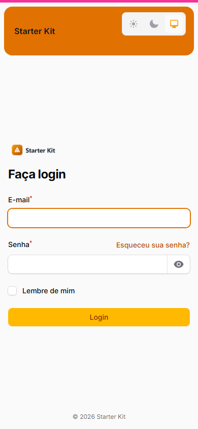](https://raw.githubusercontent.com/gsferro/filament-starter-kit-easy/main/art/telas-de-acesso-painel-celular.png) |

| Fundo de arte, destaque e rede | Tema escuro |
|---|---|
|  |  |

## Uma aparência para cada tela

O editor tem três seções recolhíveis: **Login**, **Cadastro** e **Esqueci a senha**. Cada uma tem as mesmas
opções, e as duas últimas começam com o interruptor **Igual ao login** ligado — a tela segue o login,
inclusive nas mudanças futuras. Desligado, a tela passa a ter a sua aparência, que começa como cópia
do login daquele momento. É assim que se põe, por exemplo, o formulário do login à direita e o do
cadastro e do "esqueci a senha" à esquerda.

| Seção | Vale para |
|---|---|
| **Login** | login, desafio de dois fatores, bloqueio de sessão e confirmação de e-mail |
| **Cadastro** | cadastro aberto e aceite de convite |
| **Esqueci a senha** | pedido de recuperação e redefinição de senha |

| Login em gradiente | "Esqueci a senha" com o formulário à esquerda |
|---|---|
| [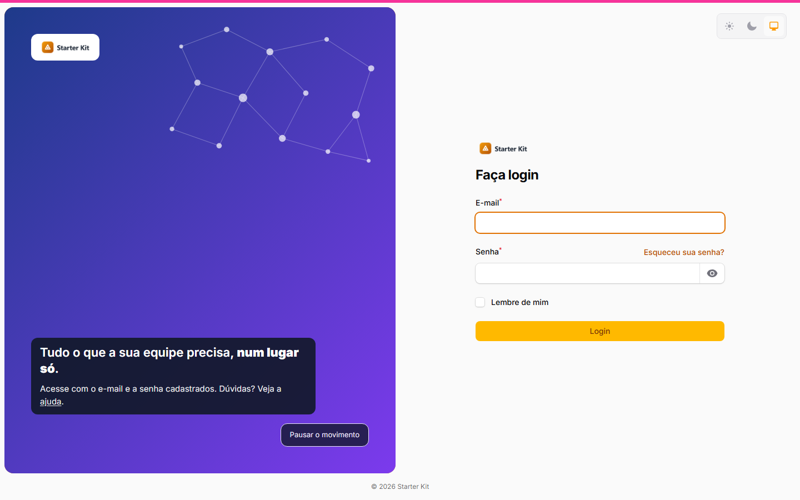](https://raw.githubusercontent.com/gsferro/filament-starter-kit-easy/main/art/telas-de-acesso-gradiente.png) | [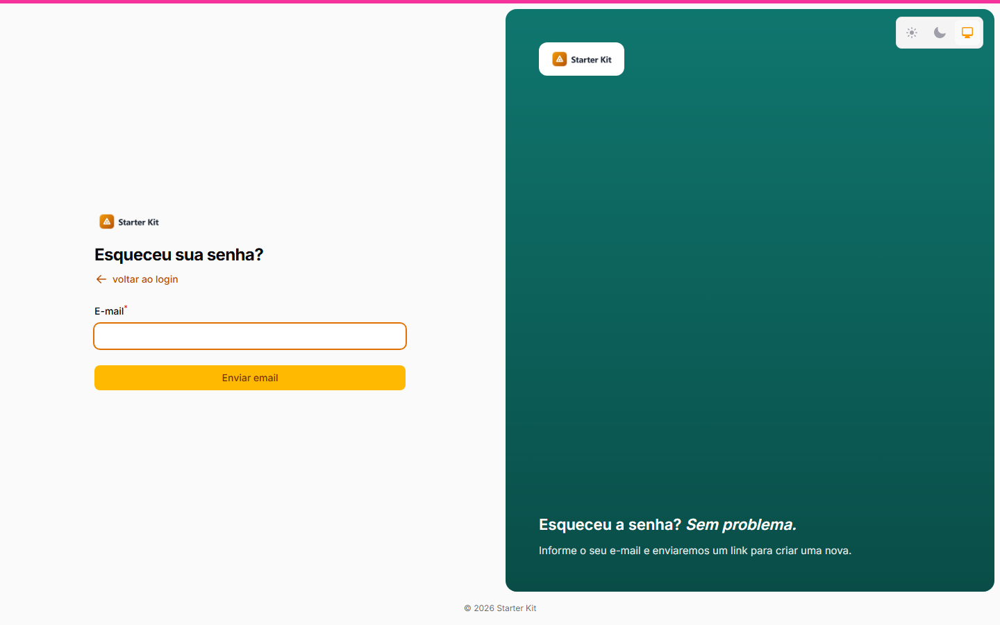](https://raw.githubusercontent.com/gsferro/filament-starter-kit-easy/main/art/telas-de-acesso-esqueci-a-senha.png) |

Cada tela pode até ter um layout diferente: o login no painel de marca e o "esqueci a senha" no
clássico, ou o contrário. A organização com aparência própria tem as seções **Login** e **Cadastro**;
"esqueci a senha" não sabe de qual organização a pessoa é e usa sempre a aparência padrão.

O login social e o desafio anti-robô continuam onde sempre estiveram, dentro do formulário, em
qualquer layout e em qualquer tela: com um provedor social configurado, o botão aparece; com a
proteção anti-robô ligada, o desafio aparece.

## As opções do painel de marca

[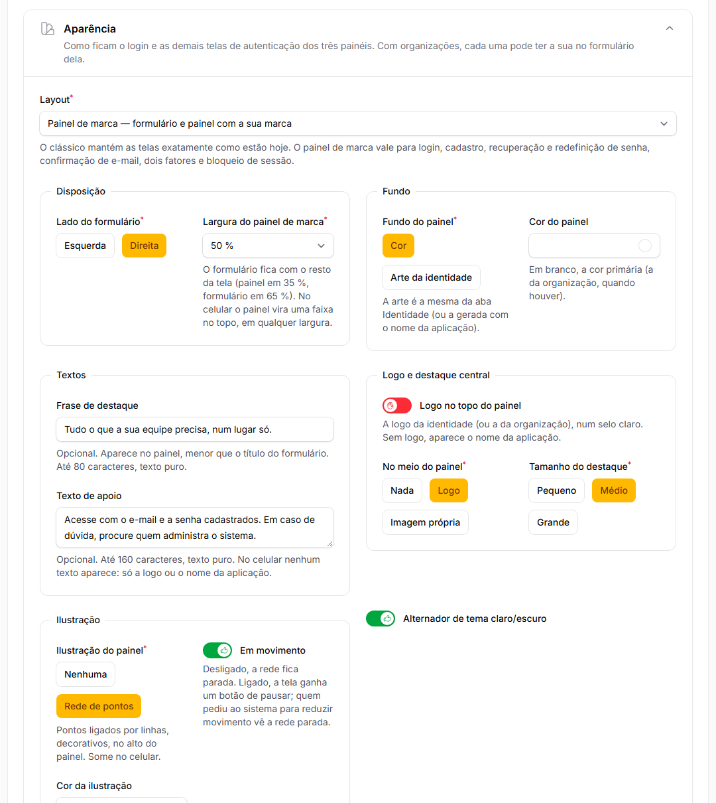](https://raw.githubusercontent.com/gsferro/filament-starter-kit-easy/main/art/telas-de-acesso-editor.png)

O editor, seção por seção — disposição, fundo, textos, ilustração, uma tela com aparência própria e o preview:

[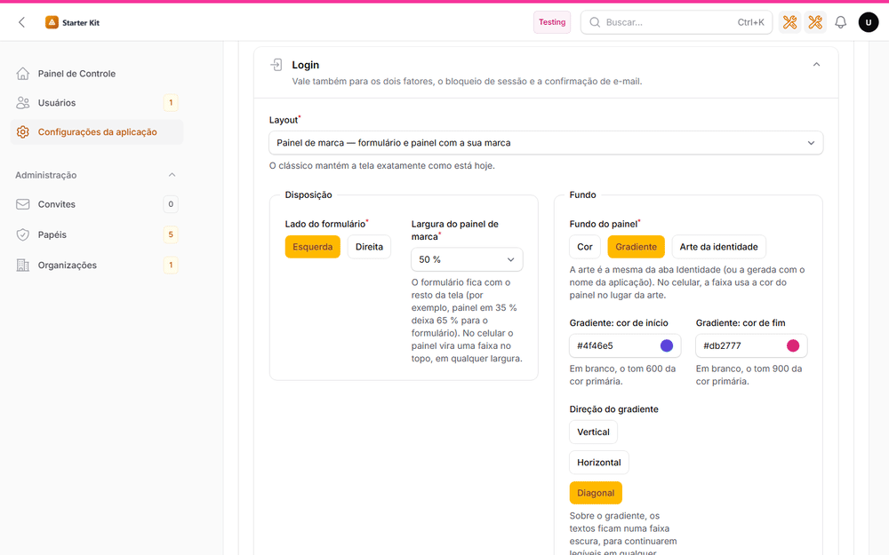](https://raw.githubusercontent.com/gsferro/filament-starter-kit-easy/main/art/telas-de-acesso-editor.gif)

| | | |
|---|---|---|
| [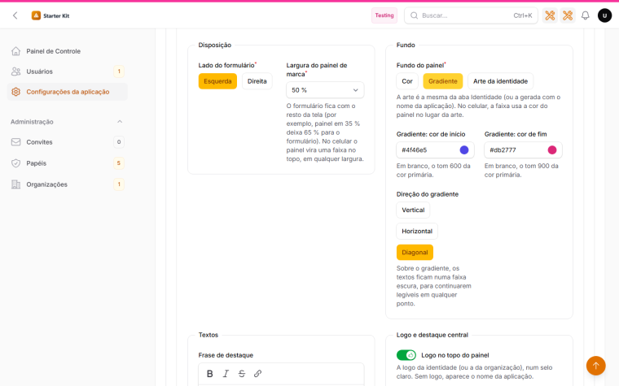](https://raw.githubusercontent.com/gsferro/filament-starter-kit-easy/main/art/telas-de-acesso-editor-2-fundo.png) | [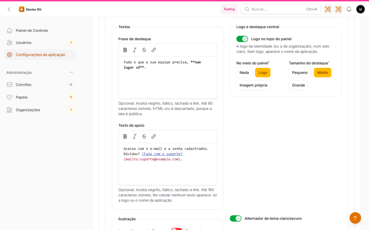](https://raw.githubusercontent.com/gsferro/filament-starter-kit-easy/main/art/telas-de-acesso-editor-3-textos.png) | [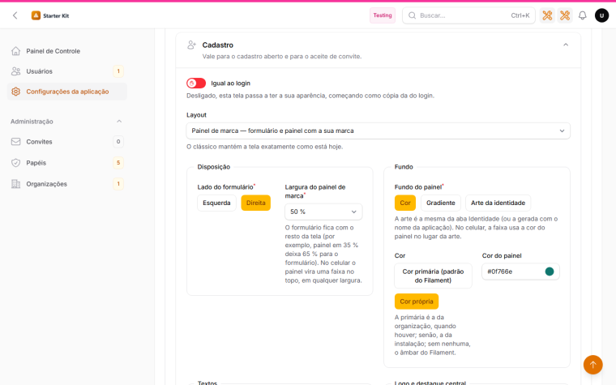](https://raw.githubusercontent.com/gsferro/filament-starter-kit-easy/main/art/telas-de-acesso-editor-5-cadastro.png) |
| *Fundo: cor, gradiente ou arte* | *Textos com negrito, itálico e link* | *Cadastro com aparência própria* |

| Opção | O que faz | Padrão |
|---|---|---|
| **Lado do formulário** | Esquerda ou direita; o painel fica do outro lado | Direita |
| **Largura do painel de marca** | De 30% a 70% da tela, de 5 em 5; o formulário fica com o resto (com 35%, o formulário ocupa 65%). É o `mediaSize` do Auth Designer. No celular não vale: lá o painel é sempre a faixa do topo | 50% |
| **Fundo do painel** | **Cor**, **Gradiente** ou **Arte da identidade** — a mesma arte da aba Identidade (ou a arte gerada com o nome da aplicação, quando nenhuma foi enviada). Sobre a arte vai um véu escuro, para o texto continuar legível | Cor |
| **Cor** | **Cor primária (padrão do Filament)** — a da organização, quando a tela é de uma organização com cor própria; senão, a da instalação; sem nenhuma, o âmbar do Filament — ou **Cor própria**, no formato `#RRGGBB`. Com uma cor clara, o texto do painel passa a escuro, para continuar legível | Cor primária |
| **Gradiente** | Duas cores `#RRGGBB` (em branco: os tons 600 e 900 da primária) e uma direção — vertical, horizontal ou diagonal. Sobre o gradiente, a frase, o apoio e o nome ficam numa faixa escura, em branco, legíveis em qualquer ponto | Diagonal |
| **Frase de destaque** | Até 80 caracteres visíveis, com **negrito**, *itálico*, ~~tachado~~ e link — a mesma barra do rodapé da tela de login. Sai no painel, sempre menor que o título do formulário | Vazia |
| **Texto de apoio** | Até 160 caracteres visíveis, com a mesma formatação, logo abaixo da frase | Vazio |
| **Logo no topo do painel** | A logo da identidade (ou a da organização) num selo claro, que funciona com qualquer cor de fundo. Sem logo enviada, aparece o nome da aplicação | Ligado |
| **No meio do painel** | **Nada**, a **Logo** (a mesma do topo, maior, num selo claro; sem logo, o nome da aplicação em letras grandes) ou uma **Imagem própria** | Nada |
| **Tamanho do destaque** | Pequeno, médio ou grande | Médio |
| **Imagem do destaque** | PNG, JPEG ou WebP, até o teto de upload do kit. SVG é recusado. Fica no disco público, em `storage/app/public/telas-de-acesso/`. Se o arquivo sumir do disco, o destaque some e a tela continua de pé | — |
| **Ilustração do painel** | **Nenhuma** ou **Rede de pontos**: pontos ligados por linhas, decorativos, no alto do painel | Nenhuma |
| **Em movimento** | Ligado, os pontos da rede flutuam devagar e a tela ganha o botão **Pausar o movimento**; quem pediu ao sistema operacional para reduzir movimento vê a rede parada. Desligado, a rede fica parada | Ligado |
| **Cor da ilustração** | Uma cor `#RRGGBB` para a rede. Em branco, a mesma cor do texto do painel | Em branco |
| **Alternador de tema** | O seletor claro/escuro/sistema no canto da tela | Ligado |
| **Transição entre as telas** | Só na seção **Login**, e vale para todas: ao ir do login para o cadastro ou o "esqueci a senha" (e de volta), o painel desliza para o lado da outra tela e o formulário aparece aos poucos. Veja abaixo | Ligada |

As frases são suas: o editor sugere um exemplo ("Tudo o que a sua equipe precisa, num lugar só."),
mas o painel só mostra o que você escrever. A formatação é em Markdown, como no rodapé da tela de
login: a tela é pública, então HTML cru é descartado, link só sai com endereço seguro, e imagem ou
título digitados não aparecem. O teto conta o texto que aparece, não a marcação (um link longo não
gasta os 80 caracteres), com um limite de 4 KB para o texto bruto. Uma frase escrita antes desta
versão continua aparecendo exatamente como antes.

**No celular**, a faixa do topo mostra **só a logo** (ou o nome da aplicação, quando não há logo).
Com fundo de arte, a faixa usa a cor do painel no lugar da imagem: a arte costuma trazer o nome da
aplicação desenhado, e ele ficaria atrás da logo.
Frase, texto de apoio, destaque e ilustração aparecem só do computador para cima (a partir de 1024 px
de largura).

O texto é sempre tratado como texto: nenhum campo aceita HTML, CSS ou script, e espaços repetidos ou
nas bordas são removidos. Uma cor fora do formato, um texto acima do teto ou uma opção fora da lista
são recusados com erro no próprio campo, e nada é salvo.

## Transição entre as telas

Com o login, o cadastro e o "esqueci a senha" no painel de marca, a troca de uma tela para a outra é
animada: quando o formulário muda de lado — por exemplo, o login com o formulário à direita e o
"esqueci a senha" à esquerda —, **só o painel desliza** para o outro lado, e o formulário **aparece aos
poucos** (fade-in), sem deslizar. Com o formulário do mesmo lado nas duas telas, o painel fica onde está
e só o conteúdo troca.

[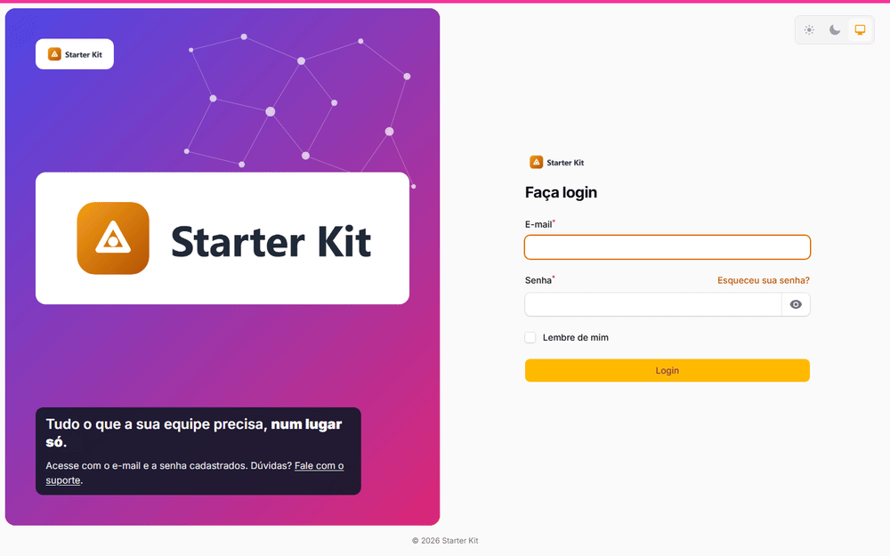](https://raw.githubusercontent.com/gsferro/filament-starter-kit-easy/main/art/telas-de-acesso-transicao.gif)

- A opção **Transição entre as telas** fica na seção **Login** e vale para todas as telas, porque a
  animação depende das duas pontas: a tela de onde se sai e a tela aonde se chega.
- Com organizações, vale a opção da instalação: o "esqueci a senha" usa sempre a aparência padrão,
  e a animação precisa das duas telas — por isso o formulário da organização não tem o interruptor.
- Só entre telas no painel de marca: indo para uma tela no clássico, ou depois de entrar no sistema, a
  troca é a de sempre.
- Só no computador (a partir de 1024 px). No celular o painel é a faixa do topo e não troca de lado.
- Quem pediu ao sistema operacional para **reduzir movimento** não vê animação.
- É a View Transitions API do navegador, sem JavaScript novo: funciona no Chrome, no Edge e no Safari
  (18.2 ou mais novo). Nos navegadores sem suporte, a tela troca sem animação, como sempre.

## O preview

[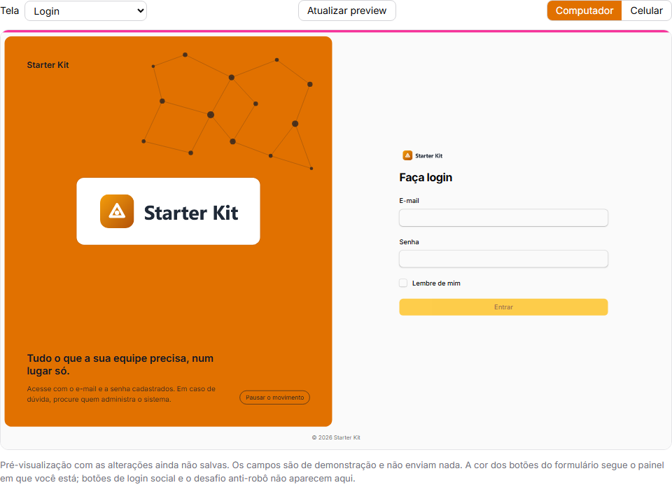](https://raw.githubusercontent.com/gsferro/filament-starter-kit-easy/main/art/telas-de-acesso-preview.png)

A seção **Pré-visualização** mostra a tela com as alterações **ainda não salvas**:

- escolha a tela (login, recuperar senha ou cadastro) e a largura (computador ou celular) — o quadro tem o tamanho de uma tela de verdade (1440×900 ou 390×844), reduzido para caber;
- uma imagem de destaque recém-enviada já aparece no preview, antes de salvar;
- o preview se atualiza sozinho quando um campo muda; o botão **Atualizar preview** força a
  atualização;
- os campos do preview são de demonstração: não fazem login, não enviam e-mail e não levam a
  provedor social.

Três limites, escritos também na própria tela:

1. O preview roda dentro do `/admin`, então os **botões do formulário** saem com a cor do painel
   admin. O painel de marca, esse sim, sai com a cor certa — inclusive a da organização.
2. Botões de login social e o desafio anti-robô **não aparecem** no preview; na tela de verdade eles
   continuam onde sempre estiveram.
3. O alternador de tema fica **desligado** no preview: ele grava a preferência no navegador, e
   clicar nele ali trocaria o tema da própria tela de configurações.

O preview só abre para quem entra no `/admin` e pode salvar aquele escopo — a aparência padrão exige a permissão da tela
de configurações; a de uma organização, a de editar (ou criar) organizações — e só com o rascunho da
própria pessoa. Endereço de preview copiado para outra pessoa, ou aberto depois de 30 minutos sem uso,
responde 404.

## Por organização

Com organizações ligadas, o formulário de cada organização
(`/admin/organizacoes/{id}/edit`, por padrão) ganha a seção **Telas de acesso**, com o interruptor **Usar a
aparência padrão**:

- **ligado** (o padrão): a organização acompanha a aparência definida em Configurações — inclusive as
  mudanças futuras;
- **desligado**: a organização passa a ter a sua. O editor começa com uma **cópia** da padrão e, a
  partir daí, ela **não acompanha** mais as mudanças da padrão. O mesmo preview, com a cor e a logo
  da organização.

Ligar o interruptor de novo descarta a aparência própria; desligá-lo depois começa de uma cópia nova
da padrão vigente.

A organização pode escolher o clássico mesmo com a padrão em painel de marca (e vice-versa).

[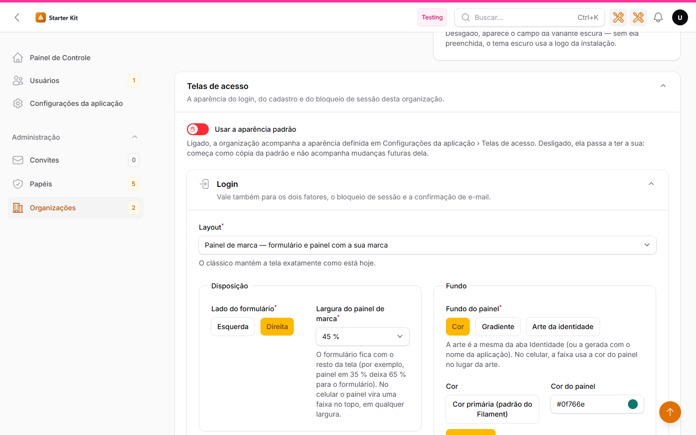](https://raw.githubusercontent.com/gsferro/filament-starter-kit-easy/main/art/telas-de-acesso-organizacao.png)

### Em que tela a aparência da organização vale

A aparência só identifica a organização onde isso é seguro e possível; no resto, vale a padrão:

| Tela | Organização considerada | Sem ela |
|---|---|---|
| Login do `/app` e `/login` | a do `?org={slug}` da URL, se estiver **ativa** | padrão |
| Cadastro do `/app` e `/cadastro` | a do cadastro aberto (`?org=`) ou a do convite | padrão |
| Bloqueio de sessão no `/app` | a organização em que a pessoa estava | padrão |
| Recuperar e redefinir senha, confirmar e-mail, dois fatores | nenhuma | padrão |
| Qualquer tela do `/admin` e do `/infra` | nenhuma | padrão |
| Qualquer tela, com organizações desligadas | nenhuma | padrão |

Encontrada a organização, vale a aparência própria dela — se ela tiver uma; senão, a padrão.

- **Login**: com `?org={slug}` na URL (`/app/login?org=acme`, ou `/login?org=acme` com a página
  única), de uma organização **ativa** — ela não precisa aceitar cadastro aberto. A aparência
  continua a mesma depois de uma senha errada.
- **Cadastro**: o cadastro aberto da organização (`?org=`) e o aceite de convite de uma organização.
- **Bloqueio de sessão**: a organização em que a pessoa estava.
- **Recuperar e redefinir senha, confirmar e-mail, dois fatores**: sempre a padrão — essas telas não
  sabem com segurança de qual organização a pessoa é.

A aparência é só aparência: ela **nunca** decide quem entra. Quem decide continua sendo a regra de
acesso de cada painel.

## Atualizando um projeto que já usa o kit

- `php artisan kit:update` entrega as classes, as views e o CSS; rode `php artisan migrate` (uma
  migration de configurações e uma coluna nova em `tenants`, as duas vazias) e
  `php artisan filament:assets`.
- Depois disso as telas continuam **idênticas**: o valor gravado nasce vazio, e vazio é o clássico.
- A troca de layout é sempre uma decisão de quem administra, na tela.

Quem personalizou à mão o bloco `AuthDesignerPlugin` dos providers continua com a sua configuração no
clássico: o layout clássico usa exatamente o que os providers montam. O painel de marca usa a arte
da aba Identidade (não a mídia do provider) e o alternador que os providers configuraram, e decide sozinho
o resto (a largura e o lado escolhidos na tela, sem desfoque).

Uma aparência de painel salva antes das opções de largura, destaque e ilustração continua igual no
computador: o que ela não tem vale o padrão — 50%, sem destaque, sem ilustração. No celular, como
toda aparência de painel, a faixa passa a mostrar só a logo ou o nome (a frase sai).

## Como funciona por dentro

Para quem vai estender o kit:

- `App\Support\AparenciaDasTelasDeAcesso` é o decisor: lê a aparência (da instalação, ou da
  organização com queda para a da instalação), reduz qualquer valor gravado ao vocabulário — um valor
  desconhecido nunca derruba a tela de login, volta ao clássico com um aviso no log `autenticacao` —
  e aplica o layout sobre a configuração que os providers dão ao `caresome/filament-auth-designer`.
- Toda página de autenticação do kit usa o trait `App\Filament\Concerns\VesteAparenciaDasTelas` e
  sobrescreve `getAuthDesignerConfig()` numa linha. Página nova de autenticação faz o mesmo — e, como
  toda página de autenticação, redeclara `$layout`.
- O painel de marca é renderizado pela view `resources/views/filament/auth/painel-de-marca.blade.php`,
  chamada pelo partial `media` do pacote que o kit já sobrescreve. O layout do pacote **não** é
  publicado: a estrutura da tela, o rodapé e a detecção de tela de autenticação continuam os mesmos.
- O estilo está em `resources/css/filament/kit.css`, escopado em `.kit-painel-de-marca` — o
  clássico não tem essa classe e não é alcançado.
- A rede é desenhada no servidor (`AparenciaDasTelasDeAcesso::rede()`, sempre o mesmo desenho) e o
  movimento é um componente Alpine na própria view, sem script externo: ele respeita
  `prefers-reduced-motion`, para quando a aba fica oculta e tem o botão de pausar.
- A imagem do destaque só é lida de `telas-de-acesso/` no disco público: um caminho gravado fora desse
  diretório é descartado.
- A aparência da instalação mora em `ConfiguracoesDoKit::$aparencia_das_telas`
  (`config('kit.identidade.aparencia_das_telas')`); a da organização, na coluna JSON
  `tenants.aparencia_das_telas`. Vazio = clássico na instalação e "usa a padrão" na organização.
- O preview é a página `App\Filament\Pages\Auth\PreviewDasTelasDeAcesso`, na rota
  `/admin/preview-das-telas-de-acesso`, com o rascunho guardado no cache por 30 minutos numa chave do
  próprio usuário.

### Por que não um pacote separado

A personalização depende de peças que são do kit — as configurações da aplicação, as organizações, a
identidade e as permissões —, e o `kit:update` entrega arquivos do kit mas não instala pacotes novos.
Um pacote exigiria um `composer require` manual em todo projeto e um adaptador para cada uma dessas
peças. Por isso a personalização mora no kit, sobre o auth designer, sem modificá-lo.
