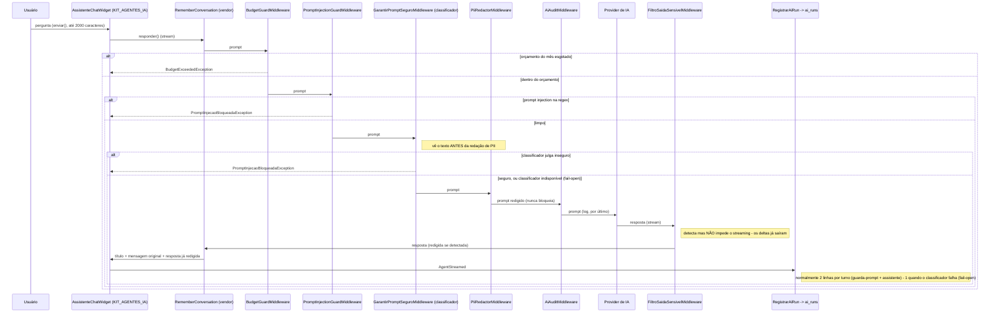

Tudo que o kit entrega, numerado, com **onde fica**, **quem alcança** e **como conferir**. Serve
para três coisas: saber o que já existe antes de reimplementar, ter um roteiro de teste manual
depois de um `kit:update`, e dar nome às features nos testes automatizados.

**A coluna "Teste"** diz o que já é verificado sozinho:

| Marca | Significa |
|---|---|
| 🟢 | coberto por teste automatizado — `composer test:kit` ou `composer test:browser` |
| 🔵 | coberto **em navegador real**, com JS executando |
| ⚪ | sem teste: depende de serviço externo (worker, cron, Docker, SMTP) ou de julgamento visual |

**A coluna "Origem"** diz de onde vem a feature: **pacote** (o pacote entrega, e o kit só registra ou configura), **código próprio** (o núcleo é do kit) ou **pacote com customização própria** (o pacote dá o núcleo, e o kit muda o comportamento). O pacote vem pelo nome do Composer ou do npm, o mesmo da [referência de pacotes instalados](../../referencia/pacotes-instalados/).

A numeração só cresce: feature nova recebe o próximo número livre, e o número de uma feature que sai continua na tabela, marcado como removido e com o motivo. As tabelas seguem a ordem dos temas, não a dos números.

Onde a rota tem `{org}`, é o modo multi-tenant — sem ele, o caminho é `/app` direto.

## Acesso e autenticação

| # | Feature | Origem | Onde | Quem alcança | Como conferir | Teste |
|---|---|---|---|---|---|---|
| F-01 | Login nos três painéis | pacote com customização própria: `filament/filament`, `caresome/filament-auth-designer` | `/app/login`, `/admin/login`, `/infra/login` | qualquer um | as três telas abrem sem autenticação, no layout de duas colunas | 🔵 |
| F-02 | Recuperação de senha | pacote com customização própria: `filament/filament` | `/{painel}/password-reset/request` | qualquer um | a tela abre; o e-mail depende de `MAIL_MAILER` | 🔵 |
| F-03 | [Registro por convite](../../autenticacao/convites/) | código próprio | `/app/register?token=…` | quem tem token válido | sem token na query, a tela recusa e manda para o login (com `KIT_REGISTRO=false`, o default) | 🟢 |
| F-03a | [Cadastro aberto](../../autenticacao/registro-aberto/) (opt-in) | código próprio | `/app/register` | qualquer um, com `KIT_REGISTRO=true` | o formulário aparece; quem se cadastra recebe **só** `panel_user` e leva 403 em `/admin` e `/infra` | 🟢 |
| F-03b | [Aprovação de cadastro](../../autenticacao/registro-aberto/) (opt-in) | código próprio | tela de usuários → ação *Aprovar* | quem pode editar usuário | com `KIT_REGISTRO_APROVACAO_MANUAL=true` o cadastro nasce pendente e não entra em painel nenhum | 🟢 |
| F-03c | [Validação de e-mail](../../autenticacao/registro-aberto/) (opt-in) | pacote com customização própria: `filament/filament` | `/app/email-verification/prompt` | autenticado, com a exigência ligada (na tela ou no `.env`) | a rota existe sempre — quem decide é um middleware do kit, por request; quem vem de convite nunca é barrado | 🟢 |
| F-04 | Autenticação em dois fatores | pacote com customização própria: `jeffgreco13/filament-breezy` | `/{painel}/two-factor-authentication` | autenticado | a tela abre e oferece o QR | 🔵 |
| F-05 | Passkeys | pacote: `jeffgreco13/filament-breezy` | — | — | desligado no kit: o Breezy nasce com `$passkeys = false`, e nenhum painel chama `enablePasskeys()` | ⚪ |
| F-06 | Bloqueio de sessão | pacote com customização própria: `marjose123/filament-lockscreen` | menu do usuário → *Bloquear sessão* | autenticado | trava sem deslogar, pelo menu ou sozinha depois de 30 min sem navegar (`LOCKSCREEN_IDLE_TIMEOUT`); volta com a senha **ou** com o login social (os mesmos botões do login). Usa o layout do login, não a `SimplePage` | 🟢 |
| F-07 | Meu perfil, avatar e senha | pacote com customização própria: `jeffgreco13/filament-breezy` | `/{painel}/meu-perfil` | autenticado | edita nome, e-mail, senha e avatar | 🔵 |
| F-08 | Impersonate | pacote com customização própria: `stechstudio/filament-impersonate` | `/admin/users` → ação na linha | `master_global` | entra como outro usuário e volta pela faixa no topo | ⚪ |
| F-72 | **[Login social por painel](../../autenticacao/login-social/)** | pacote com customização própria: `laravel/socialite` | botões abaixo do formulário de login dos três painéis; `/auth/{provedor}/redirect` e `/auth/{provedor}/callback` | qualquer um, com o provedor ligado no painel | Google, GitHub, LinkedIn e X nascem desligados e se ligam um a um, por painel, em `/admin/configuracoes-da-aplicacao` (aba Login) ou no `.env`; o botão só aparece com as credenciais completas, e e-mail que o provedor não verificou é recusado | 🔵 |
| F-73 | **[Página única de login](../../autenticacao/login-unificado/)** | código próprio | `/login` e, para quem alcança mais de um painel, `/login/painel` | qualquer um, com `KIT_LOGIN_UNIFICADO=true` | desligada de fábrica; ligada, `/admin/login`, `/infra/login` e `/app/login` levam a `/login`, quem alcança um painel entra direto e quem alcança mais de um escolhe numa tela de cartões. Cadastro e recuperação de senha passam a `/cadastro` e `/esqueci-minha-senha` | 🔵 |
| F-74 | **[Proteção anti-robô](../../autenticacao/protecao-anti-robo/)** | pacote com customização própria: `ddr/filament-captcha` | telas de login, recuperação de senha e registro dos três painéis | qualquer um, com `KIT_ANTI_ROBO=true` e as duas chaves do provedor | reCAPTCHA v2 ou v3, Turnstile ou hCaptcha, escolhidos em `/admin/configuracoes-da-aplicacao` (aba Login); nasce desligada, e sem as duas chaves continua desligada. A falha é fechada: provedor fora do ar recusa o envio. Em ambiente local o desafio fica desligado, salvo com `KIT_ANTI_ROBO_LOCAL=true` | 🔵 |
| F-75 | **[Aparência das telas de acesso](../../autenticacao/aparencia-das-telas/)** | pacote com customização própria: `caresome/filament-auth-designer` | `/admin/configuracoes-da-aplicacao` (aba Telas de acesso) e o preview em `/admin/preview-das-telas-de-acesso` | quem tem `View:ConfiguracoesDoKit` | troque o layout clássico pelo painel de marca (lado, largura, cor, gradiente ou arte, logo e duas frases) e confira no preview antes de salvar; login, cadastro e recuperação de senha podem ter cada um a sua aparência. Instalação que atualiza continua com as telas idênticas até alguém escolher | 🔵 |
| F-76 | **["+" no e-mail do cadastro](../../autenticacao/registro-aberto/)** | código próprio | `/admin/configuracoes-da-aplicacao` (aba Registro) ou `KIT_EMAIL_PERMITIR_MAIS` | quem se cadastra, é convidado ou troca o e-mail | permitido de fábrica; desligado, o "+" antes do "@" passa a ser recusado, com uma mensagem só, no cadastro aberto, no convite para conta nova, na tela de usuários do `/admin` e do `/app`, no login social que criaria conta e na troca de e-mail do perfil. Conta que já tem "+" continua entrando | 🟢 |
| F-77 | **[Conta ativa, inativa e excluída](../../autenticacao/estados-de-usuario/)** | código próprio | `/admin/users` (ações na linha) e o aviso em `/conta-indisponivel` | quem tem `Desativar:User` ou `Reativar:User` | a conta inativa passa pela senha ou pelo login social, mas cai no aviso, sem sessão; a exclusão é lógica, e a conta volta pela lista do `/admin` ou pela Lixeira do `/infra` (F-59). Ninguém desativa a própria conta nem o último `master_global` ativo, e conta indisponível não pode ser personificada | 🟢 |
| F-116 | **[Definir senha por e-mail, no perfil](../../autenticacao/login-social/)** | código próprio | `/admin/meu-perfil`, `/app/meu-perfil` e `/infra/meu-perfil` | autenticado | o bloco manda o link de redefinição do Filament para o e-mail da conta e encerra a sessão — para quem entrou pelo login social e nunca teve senha, ou esqueceu a atual. Sem ele, trocar a senha, ligar o 2FA e destravar a sessão exigiriam a senha atual | 🟢 |

## Autorização

| # | Feature | Origem | Onde | Quem alcança | Como conferir | Teste |
|---|---|---|---|---|---|---|
| F-09 | **O papel decide o painel** (`roles.painel`) | pacote com customização própria: `bezhansalleh/filament-shield` | `/admin` → Papéis | `admin`, `master_global` | crie um papel com painel `infra`: quem o tem entra no `/infra` e toma 403 no `/admin` | 🟢 |
| F-10 | 403 legível no painel errado | pacote com customização própria: `anselmokossa/filament-sentinel` | qualquer painel | — | a tela de 403 diz a conta, os papéis e oferece saída — e **não** revela permissão em produção | 🔵 |
| F-11 | `master_global` vence por `Gate::before` | código próprio | os três | `master_global` | ele entra em tudo **sem** nenhuma permission no banco | 🟢 |
| F-12 | Papéis e permissões agrupados por painel | pacote com customização própria: `bezhansalleh/filament-shield` | `/admin/shield/roles` | `admin` | a tela separa *Painel /admin*, */app* e */infra* | 🟢 |
| F-13 | `panel_user` **não** administra | código próprio | `/app{/org}` | `panel_user` | ele usa o negócio e não vê Usuários nem Convites — a matriz dele é a do painel **menos** as telas de administração | 🟢 |
| F-14 | Sem papel, ninguém entra | código próprio | os três | — | usuário autenticado sem papel toma 403 nos três. Nulo **não** é coringa | 🟢 |
| F-62 | **Toda tela do painel tem permissão própria, e ela é consultada** | pacote com customização própria: `bezhansalleh/filament-shield` | `/admin/shield/roles` → abas *Pages* e *Widgets* | `admin` | desmarque `View:Pulse` no papel `infra`: a tela responde 403 e o item sai do menu. Vale para as 7 Pages e os 24 Widgets do kit **e** para as 7 telas que vêm de pacote no `/infra` — exceto as três da Central de comandos, ver F-67 | 🟢 |
| F-63 | **Toda action e todo link do kit tem permissão própria** | pacote com customização própria: `bezhansalleh/filament-shield` | `/admin/shield/roles` → aba *Resources* e *Custom* | `admin` | desmarque `Reenviar:Convite`: o botão *Reenviar* sai da listagem de convites. As de RelationManager (vincular, desvincular, atribuir papéis) idem | 🟢 |
| F-64 | [Action e link novos **não** nascem abertos por esquecimento](../../operacao/depois-de-criar-resources/) | código próprio | `tests/Kit/PermissoesDeAcoesTest.php` | — | acrescente uma `Action::make('x')` em `app/Filament/` e rode a suíte: o caso do inventário fica vermelho nomeando o arquivo | 🟢 |
| F-65 | **[Boas-vindas na raiz](../../autenticacao/rota-publica/)**, com o que a instalação personalizou | pacote com customização própria: `harvirsidhu/filament-cards` | `/` | anônimo | abra sem autenticar: os três cartões e a config aparecem, e nada de segredo — o caso planta sentinela em 8 valores e assere a ausência | 🟢 |
| F-66 | [A raiz herda tema e cor do projeto](../../autenticacao/rota-publica/) | código próprio | `/` | anônimo | troque `KIT_COR_PRIMARIA`, rode `npm run build` e recarregue: o botão muda de cor. Sem o `panel:app` da rota, sairia âmbar | 🟢 |
| F-67 | As três exceções estão **declaradas**, não escondidas | pacote com customização própria: `ssbityukov/filament-command-center` | `/infra/command-center/commands` | `infra` | desmarque `View:Commands`: a tela **continua** abrindo. O pacote expõe um callback só para as três Pages dele, e a barreira delas é `command-center:access`. `tests/Kit/PermissoesDeTelasTest.php` tem o caso que assere essa lacuna e fica vermelho no dia em que ela fechar | 🔵 |
| F-68 | **[Hub de navegação em cartões](../../recursos/hub-de-navegacao/)** | pacote com customização própria: `harvirsidhu/filament-cards` | `/infra/hub-de-infraestrutura` (sempre); `/admin/hub-de-administracao` e `/app{/org}/hub-do-negocio` com `KIT_HUB=true` | quem entra no painel | abra o hub do `/infra`: uma grade de cartões, um por destino que o seu papel alcança. Com `KIT_HUB=false` os hubs de `/admin` e `/app` somem do menu e da busca ⌘K, e a URL responde 403 | 🟢 |
| F-120 | **Travas de escalada de papéis** | código próprio | `/admin/users` (cadastro e edição), os convites e `/admin/shield/roles` | `admin`, `master_global` | só quem já é `master_global` concede `master_global`, e quem não é concede só papel de painel que alcança; o papel fora do alcance que a pessoa já tem continua na ficha e não é revogado ao salvar. O nome reservado é recusado ao criar e ao renomear papel | 🟢 |

## Convites

| # | Feature | Origem | Onde | Quem alcança | Como conferir | Teste |
|---|---|---|---|---|---|---|
| F-15 | [Convite individual](../../autenticacao/convites/) | código próprio | `/admin/convites` · `/app/{org}/convites` | `admin`, `admin_app` | e-mail + papel + organização; o link vai por e-mail com token de uso único | 🟢 |
| F-16 | Convite para quem **já tem conta** | código próprio | mesmo lugar | idem | vira *oferta de acesso*: a pessoa entra com a senha que já tem e é vinculada | 🟢 |
| F-17 | Caixa de convites recebidos | código próprio | menu do usuário → *Convites recebidos* | quem tem `View:ConvitesRecebidos`, com multi-tenancy ligado | aceitar **ou recusar**; a recusa fica registrada. Sem multi-tenancy a tela não abre, e o link do e-mail continua sendo a via do aceite | 🟢 |
| F-18 | Convite em massa | código próprio | header da listagem | `admin`, `admin_app` | cole N endereços; um com problema **não** derruba os outros, e o resumo diz por quê | 🟢 |
| F-19 | Lembretes automáticos | código próprio | `kit:convites-lembrar` (cron 08:00) | — | D+3 e D+5, com um **segundo link paralelo**; o original continua valendo | 🟢 |
| F-20 | Reenviar / revogar | código próprio | ação na linha | `admin` | reenviar **mata** os links anteriores; revogar apaga e fica em `/infra/audits` | 🟢 |

## Multi-tenancy (opt-in)

| # | Feature | Origem | Onde | Quem alcança | Como conferir | Teste |
|---|---|---|---|---|---|---|
| F-21 | [Ligar o modo](../../recursos/multi-tenancy/) | código próprio | `php artisan kit:tenancy` | — | roda `migrate:fresh --seed`; **exige árvore git limpa** | ⚪ |
| F-22 | Painel por organização | pacote com customização própria: `filament/filament` | `/app/{org}` | vinculados | o seletor lista só as organizações do usuário; a de outro dá 404 | 🟢 |
| F-23 | Cadastro de organizações | código próprio | `/admin/organizacoes` | `admin` | create, **view** e edit em tela cheia | 🔵 |
| F-24 | Vínculo de usuários | código próprio | organização → *Usuários vinculados* | `admin` | vincular, desvincular e dar papel **naquela** organização | 🟢 |
| F-25 | `admin_app` | código próprio | `/app/{org}` | o papel | administra **uma** organização: usuários e convites recortados. Não entra no `/admin` | 🟢 |
| F-26 | [Escopo por trait](../../recursos/multi-tenancy/) | código próprio | seus models | — | `BelongsToTenant` dá relação, escopo global e preenchimento — o escopo vale em toda consulta de um request do painel com organização aberta (widget, listener), e não só nos Resources; em job, comando e seeder não há organização aberta, e a consulta volta a ser global | 🟢 |
| F-27 | **Identidade visual: cor** | código próprio | organização → *Identidade visual* | `admin` | escolha a cor e abra `/app/{org}`: o painel inteiro veste a cor dela, e o `/admin` **não** muda | 🔵 |
| F-28 | **Identidade visual: logo** | pacote com customização própria: `caresome/filament-auth-designer` | idem | `admin` | a logo aparece na tela de bloqueio do `/app` no lugar da imagem base | 🔵 |
| F-69 | **A ficha do `/app` não conta onde mais a pessoa está** | código próprio | `/app{/org}/users/{id}` | `admin_app` | abra a ficha de um colega: ela mostra a conta e **omite** as organizações e os papéis que a ficha do `/admin` mostra. Listá-los ali contaria a quem administra uma organização que aquela conta também é de outra — o recorte da consulta garante que só se veja gente DA organização corrente, não que se possa ver onde mais ela está. A ausência mora em `App\Filament\Concerns\FichaDeUsuario` | 🟢 |
| F-78 | **[Cadastro por organização](../../autenticacao/registro-aberto/)** | código próprio | `/app/register?org={slug}`, ou `/cadastro?org={slug}` com a página única de login | qualquer um, com `KIT_REGISTRO=true` e a organização aceitando cadastro público | cada organização opta em *Aceita cadastro público*, no formulário dela no `/admin` (padrão: não); sem `?org`, com slug desconhecido, organização inativa ou cadastro desligado nela, a recusa é a mesma. O link *Cadastre-se* do login só aparece com uma organização de destino | 🟢 |
| F-87 | **[Link para o painel de cada organização](../../recursos/multi-tenancy/)** | código próprio | `/admin/organizacoes` — listagem, ficha e edição | quem abre a tela de organizações | a listagem traz a coluna *Painel* com o endereço visível, abrindo em nova aba; o endereço sai do gerador de URL do painel e acompanha o slug. O link navega e não autoriza: sem papel do `/app` a resposta é 403, e sem vínculo com a organização, 404 | 🟢 |
| F-88 | **[Seletor oculto com uma organização só](../../recursos/multi-tenancy/)** | código próprio | topo da barra lateral do `/app/{org}`; o interruptor, em `/admin/configuracoes-da-aplicacao` (aba Aplicação) | quem tem acesso a uma organização ativa só | com o interruptor ligado (`KIT_TENANCY_OCULTAR_SELETOR_UNICO`, desligado de fábrica), o seletor some para quem só tem uma organização; com duas ou mais, ele continua. Esconder não muda o acesso | 🟢 |
| F-89 | **[Tela de login de cada organização](../../recursos/multi-tenancy/)** | código próprio | `/app/login?org={slug}`, ou `/login?org={slug}` com a página única; e o cadastro e o bloqueio de sessão da organização | qualquer um | no formulário da organização, desligue *Usar a aparência padrão* e escolha o clássico ou o painel de marca, com a cor e a logo dela; vale no login e no cadastro com `?org=`, no convite da organização e no bloqueio de sessão. Slug desconhecido, organização inativa e as telas do `/admin` e do `/infra` ficam com a aparência padrão | 🟢 |
| F-90 | **[Insights das organizações](../../recursos/multi-tenancy/)** | pacote com customização própria: `laboiteacode/filament-dashboard-widgets`, `gsferro/filament-stat-plus-easy` | `/admin/organizacoes` (listagem e ficha) | `admin` | acima da tabela, a visão geral com totais e organizações ativas; abaixo, usuários únicos por organização, acessos por painel e a timeline das alterações. A ficha mostra vinculados, ativos, taxa de ativação e os acessos recentes. Só contam logins bem-sucedidos, e pessoa excluída fica de fora | 🟢 |
| F-91 | **[Rótulo da organização](../../recursos/multi-tenancy/)** | código próprio | `/admin/configuracoes-da-aplicacao` (aba Aplicação), ou `KIT_TENANCY_LABEL` e `KIT_TENANCY_LABEL_PLURAL` | quem tem `View:ConfiguracoesDoKit` | troque "Organização" por Empresa, Cliente, Escola ou o que o negócio usar: com multi-tenancy, o seletor, as telas e a raiz passam a usar o rótulo, e o código continua com `Tenant` | 🟢 |
| F-92 | **Badge do papel da organização aberta** | código próprio | menu do usuário do `/app/{org}` | vinculados | quem tem papéis diferentes em cada organização (`panel_user` numa, `admin_app` noutra) vê o badge acompanhar a troca; sem papel na organização aberta, não há badge | 🟢 |

## Administração

| # | Feature | Origem | Onde | Quem alcança | Como conferir | Teste |
|---|---|---|---|---|---|---|
| F-29 | Usuários | código próprio | `/admin/users` | `admin` | create, **view** e edit em tela cheia, com papel **obrigatório** no cadastro. A ficha mostra conta, situação, origem, datas e — só aqui — as organizações e os papéis da pessoa | 🟢 |
| F-30 | Catálogo de agentes de IA | pacote com customização própria: `laravel/ai` | `/admin/agentes-ia` | `admin`, com `KIT_AGENTES_IA=true` | prompt, provider, modelo, tools e guardrails são **dados**, editáveis sem deploy. Com o uso de IA desligado (o padrão de fábrica, F-84), a tela sai do menu e a URL responde 404 | 🟢 |
| F-31 | [Autoria de onboarding](../../recursos/tutorial-guiado/) | pacote com customização própria: `wallacemartinss/filament-onboarding` | `/admin/onboarding-flows` | `admin` | checklists e tours; o consumo fica nos três painéis (F-94). Com o tutorial desligado (o padrão de fábrica), a tela sai do menu e a URL responde 404 | 🔵 |
| F-32 | Dashboard preenchido | pacote com customização própria: `gsferro/filament-stat-plus-easy`, `laboiteacode/filament-dashboard-widgets`, `leandrocfe/filament-apex-charts`, `flowframe/laravel-trend` | `/admin` | `admin` | 9 widgets: os 7 do kit sobre os dados que o painel já tem e os 2 nativos do Filament (conta e informações) | 🔵 |
| F-79 | **[Configurações da aplicação](../../recursos/configuracoes-do-kit/)** | pacote com customização própria: `spatie/laravel-settings`, `filament/spatie-laravel-settings-plugin` | `/admin/configuracoes-da-aplicacao` | quem tem `View:ConfiguracoesDoKit` (`admin`) | sete abas — Identidade, E-mail, Tabelas, Registro, Login, Telas de acesso e Aplicação —, gravadas no banco, que vence o `.env` a partir do request seguinte, sem deploy; toda alteração fica em `/infra/audits`, com a senha do e-mail mascarada | 🔵 |
| F-80 | **[Cor livre, logo por tema e cabeçalho dos painéis](../../recursos/configuracoes-do-kit/)** | código próprio | `/admin/configuracoes-da-aplicacao` (aba Identidade) | quem tem `View:ConfiguracoesDoKit` | a cor primária aceita hexadecimal livre, que vence o nome da paleta; a logo pode ser uma só ou uma por tema, e o navegador troca pelo tema; o cabeçalho escolhe o que o topo dos três painéis mostra. Dentro de `/app/{org}`, a identidade da organização vence (F-27, F-28) | 🔵 |
| F-119 | **[Envio de e-mail configurado na tela](../../recursos/configuracoes-do-kit/)** | código próprio | `/admin/configuracoes-da-aplicacao` (aba E-mail) | quem tem `View:ConfiguracoesDoKit` | transporte (`log`, `array`, `smtp`), servidor, porta, criptografia, usuário, senha e remetente valem para todo envio a partir do request seguinte; a senha é gravada cifrada e entra mascarada na trilha de `/infra/audits` | 🟢 |

## Infraestrutura

| # | Feature | Origem | Onde | Quem alcança | Como conferir | Teste |
|---|---|---|---|---|---|---|
| F-33 | Health checks | pacote com customização própria: `shuvroroy/filament-spatie-laravel-health` | `/infra/health-check-results` | `infra` | banco, cache, filas, agendador, debug mode, ambiente, app otimizado, disco (fora do Windows) e IA local. **Abre vazia até rodar `php artisan health:check`** | 🔵 |
| F-34 | Backups | pacote com customização própria: `spatie/laravel-backup`, `brimham/filament-backup-monitor` | `/infra/backup-runs` | `infra` | histórico e saúde por destino | 🔵 |
| F-35 | Filas | pacote com customização própria: `croustibat/filament-jobs-monitor` | `/infra/queue-monitors` | `infra` | pendentes, falhas e histórico — de qualquer driver | 🔵 |
| F-36 | Logs | pacote com customização própria: `laboiteacode/filament-logs-explorer` | `/infra/logs` | `infra` (`ver-logs`) | leitura e busca por channel. **Sem botão de apagar**: trilha é evidência | 🔵 |
| F-37 | Auditoria de alterações | pacote com customização própria: `owen-it/laravel-auditing`, `tapp/filament-auditing` | `/infra/audits` | `infra` | quem mudou o quê, campo a campo | 🔵 |
| F-38 | Trilha de acesso | pacote com customização própria: `tapp/filament-authentication-log` | `/infra/authentication-logs` | `infra` | logins, IP e dispositivo | 🔵 |
| F-39 | Central de comandos | pacote com customização própria: `ssbityukov/filament-command-center` | `/infra/command-center/commands` | `infra` (`command-center:access`) | comandos **pré-aprovados** em `config/command-center.php`, com histórico | 🔵 |
| F-40 | Pulse | pacote com customização própria: `laravel/pulse`, `dotswan/filament-laravel-pulse` | `/infra/pulse` | `infra` | performance em tempo real. Precisa de `pulse:check` para ter dados | 🔵 |
| F-41 | Grafo de dependências | pacote com customização própria: `laboiteacode/filament-dependency-graph` | `/infra/dependency-graph` | `infra` | mapa de models, relações, resources e painéis | 🔵 |
| F-42 | Releases do Composer | pacote com customização própria: `mominalzaraa/filament-composer-release-notifier` | `/infra/composer-release-packages` | `infra` | avisa versão nova. **Informativo — nunca atualiza nada.** O sync é um job: sem worker, a tela fica vazia | 🔵 |
| F-43 | Execuções de IA | pacote com customização própria: `fomvasss/laravel-ai-tasks` | `/infra/execucoes-ia` | `infra` (`ver-ai-tasks`) | ledger com custo e tokens por execução | 🔵 |
| F-44 | Limpar caches | pacote com customização própria: `cms-multi/filament-clear-cache` | topbar do `/infra` | `infra` | `cache`, `config` e `view` juntos, e o `modelCache` com `MODEL_CACHE_ENABLED=true` | ⚪ |
| F-57 | [Exceções agrupadas](../../recursos/trilhas-de-infraestrutura/) | pacote com customização própria: `bezhansalleh/filament-exceptions` | `/infra/exceptions` | `infra` | por tipo e frequência, com badge no menu. A retenção (`KIT_RETENCAO_EXCECOES_DIAS`) só acontece **com o agendador rodando** | 🟢 |
| F-58 | [Trilha de e-mails](../../recursos/trilhas-de-infraestrutura/) | pacote com customização própria: `tapp/filament-maillog` | `/infra/mail-logs` | `infra` | todo e-mail enviado. Guarda o **corpo** — inclusive o link de aceite do convite | 🟢 |
| F-59 | [Lixeira](../../recursos/trilhas-de-infraestrutura/) | pacote com customização própria: `promethys/revive` | `/infra/recycle-bin` | `infra` | restaura o que foi apagado com `SoftDeletes`. Lista **só** as models declaradas em `models()` no `InfraPanelProvider` | 🟢 |
| F-85 | **Dashboard do `/infra` preenchido** | pacote com customização própria: `gsferro/filament-stat-plus-easy`, `laboiteacode/filament-dashboard-widgets`, `leandrocfe/filament-apex-charts` | `/infra` | `infra` | 19 widgets: os 17 do kit — saúde, filas, backups, pacotes, IA, acessos e auditoria — e os 2 nativos do Filament; os números somam todas as organizações, e cada widget consulta a própria permissão (F-62) | 🔵 |

## Produtividade e UI

| # | Feature | Origem | Onde | Quem alcança | Como conferir | Teste |
|---|---|---|---|---|---|---|
| F-45 | [Busca ⌘K](../../referencia/busca-e-idioma/) | pacote com customização própria: `wezlo/filament-search-spotlight` | topbar dos três | autenticado | registros, telas, páginas e ações "Criar X" — **tudo recortado por permissão** | 🔵 |
| F-46 | Badges de contagem animados | pacote com customização própria: `gsferro/filament-odometer-easy`, `gsferro/odometer-easy` | menu lateral | autenticado | a contagem sai de `getEloquentQuery()`; zero não vira badge | 🟢 |
| F-47 | Centro de notificações | pacote: `prodstarter/filament-notification-center`, `laravel/reverb` | sininho | autenticado | abas e categorias; tempo real com Reverb, senão polling de 30 s | ⚪ |
| F-48 | Troca de painel | pacote com customização própria: `bezhansalleh/filament-panel-switch` | menu do usuário | quem alcança mais de um | vai direto ao painel escolhido | 🔵 |
| F-49 | **Tema claro/escuro** | pacote com customização própria: `filament/filament`, `caresome/filament-auth-designer` | alternador no topo | qualquer um | as telas seguem `prefers-color-scheme` e o alternador; a escolha persiste | 🔵 |
| F-50 | Colunas redimensionáveis | pacote com customização própria: `asmit/resized-column` | qualquer tabela | autenticado | largura ajustável em qualquer tabela, lembrada na sessão nas 7 listagens do kit que usam `HasResizableColumn` | ⚪ |
| F-51 | Indicador de ambiente | pacote: `pxlrbt/filament-environment-indicator` | topbar | qualquer um | badge de `local`/`homologação`; some em produção | 🔵 |
| F-52 | Páginas de erro brandadas | pacote com customização própria: `anselmokossa/filament-sentinel` | 403, 404, 419, 500, 503 | — | com a cara do painel, em pt-BR | 🔵 |
| F-60 | **[Seletor de idioma](../../referencia/busca-e-idioma/)** | pacote com customização própria: `bezhansalleh/filament-language-switch`, `laravel-lang/common` | topbar dos três e telas de login | qualquer um | só aparece com **dois** locales em `kit.idiomas`; traduz Filament e pacotes, **não** os rótulos do kit | 🟢 |
| F-61 | **[Anexos e mídia](../../recursos/anexos-e-midia/)** | pacote com customização própria: `filament/spatie-laravel-media-library-plugin`, `solution-forest/filament-simplelightbox` | formulário e tabela de Projetos | quem alcança o resource, que só existe com multi-tenancy e `KIT_DEMO=true` | upload, coleção `anexos`, conversão `miniatura` e lightbox na tabela. O anexo herda o escopo da organização do próprio registro | 🟢 |
| F-70 | **Cabeçalho rico nas telas de registro** | pacote com customização própria: `mortalkiller/filament-page-header` | ver e editar usuário (`/admin` e `/app`) e organização (`/admin`) | quem alcança a tela | no lugar do título de texto do Filament: avatar (ou as iniciais, quando não há foto), nome, badge de situação e metadados copiáveis. Vem de `mortalkiller/filament-page-header`; o conteúdo é o mesmo nos dois painéis, em `App\Filament\Concerns\CabecalhoDeUsuario`, porque o que uma conta **é** não muda por painel | 🟢 |
| F-71 | **Avatar de iniciais desenhado aqui dentro** | código próprio | todo avatar sem foto, nos três painéis | qualquer um | abra qualquer tela e olhe a aba de rede: nenhuma requisição sai da aplicação. O provider padrão do Filament é o `UiAvatarsProvider`, que fazia o navegador de **cada** pessoa pedir `ui-avatars.com` a cada carga de tela — levando as iniciais na query string e o `Referer` do painel junto. `App\Support\AvatarDeIniciais` devolve um SVG embutido, com a mesma aparência | 🟢 |
| F-81 | **[Rodapé com assinatura e versão do sistema](../../recursos/configuracoes-do-kit/)** | código próprio | rodapé dos três painéis e das telas de autenticação | a assinatura, qualquer um; a versão, só quem entrou | o `©` com o ano e o nome da aplicação aparece para todos, inclusive no login; a versão do seu sistema (campo *Versão do sistema*, semeado por `APP_VERSION`) e a do kit, com o interruptor, só para quem entrou — exibir a versão no login entregaria a lista de vulnerabilidades da instalação | 🔵 |
| F-82 | **[Aviso de alterações não salvas](../../recursos/configuracoes-do-kit/)** | pacote: `filament/filament` | formulários dos três painéis | autenticado | saia de um formulário alterado e a tela pede confirmação antes de descartar; o interruptor fica em `/admin/configuracoes-da-aplicacao` (`KIT_ALERTA_ALTERACOES_NAO_SALVAS`, ligado de fábrica) | 🔵 |
| F-83 | **[Densidade do layout e aparência de cada pessoa](../../recursos/configuracoes-do-kit/)** | código próprio | `/admin/configuracoes-da-aplicacao` (aba Aplicação) e o *Meu perfil* de cada um | autenticado; a escolha pessoal, com `KIT_APARENCIA_POR_USUARIO` ligado | confortável, compacto ou denso apertam de uma vez cartões, tabelas, menu e botões dos três painéis, no próximo F5 e sem build; cada pessoa pode escolher densidade, fonte, cor e modo do menu, e dentro de uma organização a escolha pessoal só vale se a organização a liberar | 🔵 |
| F-86 | **[Dashboard dinâmico](../../recursos/configuracoes-do-kit/)** | pacote com customização própria: `mddev31/filament-dynamic-dashboard` | `/admin/dashboard-dinamico`, `/app/dashboard-dinamico` e `/infra/dashboard-dinamico` | quem entra no painel; montar a grade exige `Manage:Dashboard` | com `KIT_DASHBOARD_DINAMICO=true` (desligado de fábrica), a tela de entrada vira uma grade que a pessoa monta, move e redimensiona; desligar não apaga as grades. Com multi-tenancy, cada organização tem a sua, e a organização nova nasce com a grade padrão | 🔵 |
| F-93 | **[Dock de atalhos](../../recursos/dock-de-atalhos/)** | pacote com customização própria: `hoceineel/filament-quick-action-dock` | botão flutuante nos painéis marcados em `/admin/configuracoes-da-aplicacao` (aba Aplicação) ou em `KIT_DOCK_PAINEIS` | quem tem `Usar:Dock` | desligado de fábrica, sem painel marcado; até 10 favoritos por pessoa, de qualquer painel, gerenciados num slideover. Some na tela de bloqueio e nas telas de login | 🔵 |
| F-94 | **[Tutorial guiado](../../recursos/tutorial-guiado/)** | pacote com customização própria: `wallacemartinss/filament-onboarding` | `/admin/onboarding`, `/app/onboarding` e `/infra/onboarding` (*Primeiros passos*), com o checklist flutuante | quem tem `View:PrimeirosPassos` | desligado de fábrica (`KIT_ONBOARDING=false`); semear (`OnboardingSeeder` ou `kit:install --onboarding`) cria as jornadas, e o interruptor em `/admin/configuracoes-da-aplicacao` liga o checklist, os tours e a página. Desligado, as telas do tutorial respondem 404 | 🔵 |
| F-95 | **[Visões salvas de tabela](../../recursos/visoes-de-tabela-e-carregamento/)** | pacote com customização própria: `sehsah/filament-remember-table` | botão *Visões* nas listagens do kit, nos três painéis | autenticado; salvar exige `Usar:VisoesDeTabela` | desligadas de fábrica (`KIT_TABELA_VISOES_SALVAS`); ligadas na aba Tabelas, gravam filtros, busca, ordenação, agrupamento e colunas com nome, por usuário e por organização, com visão padrão, compartilhamento opcional e `?view=` na URL | 🟢 |
| F-96 | **[Carregamento contínuo de tabela](../../recursos/visoes-de-tabela-e-carregamento/)** | pacote com customização própria: `asignua/filament-infinite-scroll` | toda tabela dos três painéis | autenticado | nasce em paginação; na aba Tabelas de `/admin/configuracoes-da-aplicacao` (`KIT_TABELA_CARREGAMENTO`), troque por rolagem infinita ou pelo botão *Carregar mais*, um bloco do tamanho de "Linhas por página" por vez | 🔵 |
| F-97 | **[Import e export em CSV](../../recursos/import-export-csv/)** | pacote com customização própria: `filament/filament` | cabeçalho das listagens de Agentes de IA (`/admin/agentes-ia`), Organizações (`/admin/organizacoes`, só export), Execuções de IA (`/infra/execucoes-ia`, só export) e Projetos (`/app/{org}/projetos`) | quem tem `Import:{Model}` ou `Export:{Model}` | o import respeita a fronteira da organização, e o export neutraliza fórmula em toda coluna; os dois são jobs, e sem worker nada sai. Em Usuários e Convites a Action vem comentada, pronta para ligar | 🔵 |
| F-98 | **[Defaults globais de tabela, modal e toggle](../../recursos/configuracao-global-filament/)** | código próprio | toda tabela, modal, toggle e coluna dos três painéis, inclusive nas telas de plugin | autenticado | tabela listrada e empilhada no celular, com o recorte do usuário preservado na sessão, colunas reordenáveis e fixáveis e 10 linhas por página; modal que não fecha no Esc. Sete desses defaults se editam na aba Tabelas de `/admin/configuracoes-da-aplicacao` | 🟢 |
| F-99 | **UI 100% em pt-BR, inclusive nos plugins** | pacote com customização própria: `laravel-lang/common` | os três painéis e as telas de login | qualquer um | `APP_LOCALE=pt_BR` no `.env.example`; as traduções do Laravel vêm publicadas em `lang/pt_BR`, o Filament já traz as dele, e as dos plugins que só trazem inglês o kit escreveu em `lang/vendor/` | ⚪ |
| F-100 | **[Mídia em disco privado, servida por URL assinada](../../recursos/anexos-e-midia/)** | pacote com customização própria: `filament/spatie-laravel-media-library-plugin` | os anexos de Projetos e `php artisan kit:midia-privada` | quem alcança o resource; o comando, quem opera o servidor | o disco da mídia nasce privado (`MEDIA_DISK=local`) e o arquivo só abre por URL assinada — a mesma URL sem assinatura é recusada; `kit:midia-privada` move para o disco privado o que já estava gravado em disco público, e `--dry-run` só relata | 🟢 |
| F-101 | **[Teto de upload de 10 MB e SVG recusado](../../recursos/configuracoes-do-kit/)** | código próprio | todo campo de arquivo dos três painéis | autenticado | o teto de fábrica é de 10 MB (`KIT_UPLOAD_MAXIMO_MB`), alinhado ao upload temporário do Livewire, e o arquivo acima dele é recusado no formulário, em megabytes; SVG é recusado porque XML aceita `<script>` | 🟢 |
| F-118 | **Botão "Voltar ao topo"** | código próprio | toda tela dos três painéis, inclusive as de plugin | qualquer um | o botão aparece depois de 400 px de rolagem e sobe acima do chat do assistente quando ele está na tela, sem colidir | 🟢 |

## IA

| # | Feature | Origem | Onde | Quem alcança | Como conferir | Teste |
|---|---|---|---|---|---|---|
| F-53 | Chat do assistente | pacote com customização própria: `laravel/ai` | canto de **toda** tela dos painéis listados em `KIT_AGENTES_IA_PAINEIS` (nenhum de fábrica) | autenticado, com `KIT_AGENTES_IA=true` (F-84) | streaming; renderiza vazio sem usuário | ⚪ |
| F-54 | Guardrails encadeados | pacote com customização própria: `laravel/ai`, `fomvasss/laravel-ai-tasks` | — | — | budget, prompt injection, classificador local, redação de PII e filtro de saída. **Fail-closed** na montagem: agente sem guardrail não sobe. O classificador local é fail-open (fora do ar, o chat segue com as outras camadas), e o filtro de saída detecta sem interromper o streaming — ver a sequência abaixo | 🟢 |
| F-55 | Ledger de execuções | pacote com customização própria: `fomvasss/laravel-ai-tasks` | `/infra/execucoes-ia` | `infra` | toda chamada vira linha com custo e tokens | 🟢 |
| F-56 | Inferência local | pacote com customização própria: `laravel/ai` | `docker compose --profile ai up -d` | — | llama.cpp; ou troque `AI_PROVIDER` por um SaaS | ⚪ |
| F-84 | **[Interruptor da IA e painéis do chat](../../recursos/configuracoes-do-kit/)** | código próprio | `/admin/configuracoes-da-aplicacao` (aba Aplicação), ou `KIT_AGENTES_IA` e `KIT_AGENTES_IA_PAINEIS` | quem tem `View:ConfiguracoesDoKit` | desligado de fábrica: o catálogo de agentes (F-30) sai do menu e responde 404, e o chat (F-53) não aparece em painel nenhum; ligado, a lista escolhe em quais painéis o chat aparece, e vazia quer dizer nenhum | 🟢 |

### Sequência do assistente, do prompt ao ledger

O widget entra em duas fases: `enviar()` valida a pergunta (até 2000 caracteres,
`app/Livewire/AssistenteChatWidget.php:Validate:47`) e guarda como pendente; `responder()` streama
pelo agente. O SDK envolve o pipeline com `RememberConversation` **antes** de `middleware()` rodar,
porque `Assistente` usa `RemembersConversations`
(`vendor/laravel/ai/src/Providers/Concerns/GeneratesText.php:RemembersConversations:148`); dentro
dele, a ordem é a do catálogo `agentes_ia.guardrails`, resolvida por `GuardrailRegistry::MAPA`
(`app/Ai/Guardrails/GuardrailRegistry.php:MAPA:23-27`) e semeada por
`database/seeders/AssistenteSeeder.php:guardrails:39`, com `BudgetGuardMiddleware` primeiro
(`app/Ai/Agents/AgenteBase.php:middleware:66`) e `AiAuditMiddleware` por último
(`app/Ai/Agents/Assistente.php:middleware:61`).

O ledger nasce de um listener de evento, nunca de uma chamada direta:
`Event::listen([AgentPrompted::class, AgentStreamed::class], RegistrarAiRun::class)`
(`app/Providers/KitServiceProvider.php:AgentStreamed:524`), e `RegistrarAiRun::handle()` grava em
`ai_runs` com `status: 'ok'` (`app/Ai/Listeners/RegistrarAiRun.php:AiRun::create:44`) — pedido
bloqueado por qualquer camada acima **não** chega a esta linha. O widget existe nos painéis que a tela de
configurações escolher, montado por um render hook global
(`app/Providers/Concerns/ConfiguraFilamentGlobal.php:configuraChatDoAssistente:184`) decidido por
`App\Support\AgentesDeIa` a cada request — e só com o uso de agentes ligado (`KIT_AGENTES_IA`).

## Instalação e operação

| # | Feature | Origem | Onde | Quem alcança | Como conferir | Teste |
|---|---|---|---|---|---|---|
| F-102 | **[Instalador que pergunta cinco coisas](../../comecar/instalacao-avancada/)** | código próprio | `php artisan kit:install`, chamado pelo `composer create-project` | quem instala | nome do projeto, banco (SQLite, PostgreSQL ou MySQL), e-mail e senha do administrador, cor primária e multi-organização; Enter em tudo instala com os padrões, e sem terminal nada é perguntado. No fim, o resumo do que mudou e a oferta de rodar os testes do kit | 🟢 |
| F-103 | **[Troca do administrador pela linha de comando](../../comecar/instalacao-avancada/)** | código próprio | `php artisan kit:admin` | quem opera o servidor | troca e-mail e senha do `master_global`, com confirmação; recusa e-mail que já é de outra conta e para quando há mais de um administrador, em vez de adivinhar qual | 🟢 |
| F-104 | **[Como o projeto está customizado](../../comecar/instalacao-avancada/)** | código próprio | `php artisan kit:info` | quem opera o servidor | mostra nome, cor e as demais escolhas da instalação, e de onde cada valor vem — o banco vence o arquivo de configuração; com multi-tenancy, lista as organizações | 🟢 |
| F-105 | **[Atualização a partir de uma versão nova do kit](../../comecar/atualizando-o-projeto/)** | código próprio | `php artisan kit:update` | quem mantém o projeto | compara a versão do projeto com uma tag nova do kit só nos caminhos que pertencem ao kit — o código do seu negócio nunca entra na conta — e aplica arquivo a arquivo, com a sua aprovação; `--dry-run` só mostra o que mudou | 🟢 |
| F-106 | **[Domínio local por nome](../../comecar/dominio-local/)** | código próprio | oferecido no fim do `php artisan kit:install` | quem instala | no lugar de IP e porta, `http://meu-projeto.test`: o instalador sugere o domínio pelo nome do projeto, escreve a linha no arquivo `hosts` (pedindo elevação no Windows) e ajusta a `APP_URL`. É opt-in, e nenhum arquivo versionado muda | 🟢 |
| F-107 | **[Containers Docker por profile](../../comecar/instalacao-avancada/)** | código próprio | `docker-compose.yml` | quem opera o ambiente | `docker compose up -d` sobe PostgreSQL com pgvector e Redis; o profile `ai` traz o llama.cpp, `mail` o Mailpit, `app` a aplicação containerizada com nginx, worker, agendador, Reverb e Pulse, `realtime` só o Reverb e o Pulse, e `full` o llama.cpp e o Mailpit juntos; o MySQL sobe pelo nome do serviço | ⚪ |
| F-108 | **[Atualização da stack no host dos containers](../../operacao/deploy-docker-multiambiente/)** | código próprio | `./deploy_docker_local.sh` | quem opera o host dos containers | `git pull`, rebuild da imagem depois do pull, `--profile app up -d`, migrations, `optimize:clear`, health check em `/up` e sonda do Reverb; `--recreate` recria os containers quando o `.env` mudou | 🟢 |
| F-109 | **[Vários ambientes no mesmo servidor](../../operacao/deploy-docker-multiambiente/)** | código próprio | `docker/traefik/docker-compose.override.yml`, copiado para a raiz do checkout | quem opera o servidor | dev, teste e homologação do mesmo projeto, cada um com containers, banco e volumes próprios, atrás de um Traefik que roteia por hostname; sem o override nada muda, e os proxies confiáveis só valem com `TRUSTED_PROXIES` no `.env` | 🟢 |
| F-110 | **[Model caching opcional](../../referencia/pacotes-instalados/)** | pacote com customização própria: `mike-bronner/laravel-model-caching` | as models com Resource no `/app` — `User`, `Convite` e `Projeto` | — | desligado de fábrica (`MODEL_CACHE_ENABLED=false`); ligado, com `MODEL_CACHE_STORE=model-cache`, a consulta repetida sai do Redis, e `save`, `update` e `delete` limpam o cache da model. O `/admin` e o `/infra` ficam sem cache, e o botão de limpar caches (F-44) passa a incluir o `modelCache` | 🟢 |
| F-117 | **[Endereços limpos com o DocumentRoot na raiz](../../recursos/configuracao-global-filament/)** | código próprio | todo request, por um middleware global | — | em hospedagem que reescreve tudo para dentro da pasta `public` sem apontar o `DocumentRoot` para ela, o Laravel geraria endereços com esse segmento; o kit detecta a reescrita no `.htaccess` da raiz e tira o segmento, sem tocar na instalação correta. `KIT_URL_REMOVER_SUFIXO_PUBLIC=true` força (nginx), e `false` desliga | 🟢 |
| F-121 | **Senha forte e comandos destrutivos bloqueados em produção** | código próprio | toda regra de senha e o `php artisan`, com `APP_ENV=production` | — | em produção, a senha exige 12 caracteres, com maiúscula, minúscula, número e símbolo, e é recusada se aparece em vazamento conhecido; `migrate:fresh` e os demais comandos destrutivos do banco ficam bloqueados. Fora de produção, a senha pede 8 caracteres | ⚪ |

## Desenvolvimento

| # | Feature | Origem | Onde | Quem alcança | Como conferir | Teste |
|---|---|---|---|---|---|---|
| F-111 | **[DTO com Laravel Data](../../recursos/dto-com-laravel-data/)** | pacote com customização própria: `spatie/laravel-data` | `app/Data/` | quem desenvolve no kit | dado estruturado que cruza a fronteira de uma classe viaja como objeto tipado; uma guarda executável reprova o Data sem a herança do pacote, credencial dentro de DTO e consumo ou resposta de API sem um | 🟢 |
| F-112 | **[Gates de qualidade](../../referencia/qualidade-de-codigo/)** | pacote com customização própria: `larastan/larastan`, `laravel/pint`, `laraveldaily/filacheck`, `happenv-com/filament-phpstan-macros`, `rector/rector`, `driftingly/rector-laravel`, `pestphp/pest`, `pestphp/pest-plugin-laravel`, `pestphp/pest-plugin-phpstan`, `pestphp/pest-plugin-mutate`, `phpunit/phpunit`, `brianium/paratest`, `mockery/mockery`, `fakerphp/faker`, `icanhazstring/composer-unused`, `maglnet/composer-require-checker` | `composer test`, `composer test:kit`, `composer test:coverage` e o workflow de CI | quem desenvolve no kit | `composer test` roda Pint, PHPStan no nível 8, FilaCheck e as suítes; o CI repete Pint, PHPStan e as suítes em paralelo, roda as telas em navegador e mede a cobertura com piso de 78 %, e o `deps:check` sai lá como relatório, sem reprovar. Rector e mutation ficam sob demanda | 🟢 |
| F-113 | **[Imagens do README geradas por teste](../../referencia/qualidade-de-codigo/)** | pacote com customização própria: `pestphp/pest-plugin-browser`, `playwright` | `composer art` e `php artisan kit:arte` | quem desenvolve no kit | os testes de navegador capturam as telas, e o `kit:arte` monta os quadros e os clipes animados; todo quadro declarado tem quem o capture, e clipe incompleto é relatado sem derrubar os outros | 🟢 |
| F-114 | **[Preparado para agentes de código](../../operacao/agentes-de-ia/)** | pacote com customização própria: `laravel/boost`, `laravel/pao` | `.ai/rules/`, `.claude/agents/` e as skills do kit | quem desenvolve com um agente | o Boost entrega o servidor MCP e as guidelines; as rules do kit, por caminho, dizem ao agente o que vale em cada pasta; as skills e os sub-agentes chegam pelo `kit:update`; e o `laravel/pao` troca a saída de testes e análise por JSON só quando quem roda é um agente | 🟢 |
| F-115 | **[Convenções do kit](../../operacao/convencoes-do-kit/)** | código próprio | os models e as rotas dos três painéis | quem desenvolve no kit | UUID nas rotas e `id` inteiro como chave primária, pelo trait `TemUuid` — URL com id numérico devolve 404; datas imutáveis; tradução de plugin em `lang/vendor/`; e as demais regras da página | 🟢 |

## O que o roteiro **não** cobre sozinho

Algumas features dependem de coisa fora do processo, e nenhum teste as substitui:

| Feature | Depende de | Sem isso |
|---|---|---|
| F-57, F-58 (retenção das trilhas) | o scheduler (`schedule:work`) | as tabelas de exceções e de e-mails crescem sem teto; o prazo em `config/kit.php` fica só declarado |
| F-15…F-20 (entrega do e-mail) | `MAIL_MAILER` real **e** um worker (`QUEUE_CONNECTION=database`) | o convite é gravado e a fila enche; nada sai |
| F-33 (health checks) | uma execução de `php artisan health:check` | a tela abre **vazia**, sem estado explicando — o widget do dashboard avisa, a página do recurso não |
| F-35, F-42 (filas e releases) | um worker | o job de sync do Composer fica na fila: F-42 mostra "sem registros" e F-35 conta pendências contra uma tabela vazia |
| F-97 (import e export) | um worker | o arquivo é aceito e a linha entra em `imports` ou `exports`, mas a notificação de conclusão nunca chega |
| F-19 (lembretes) | o scheduler (`schedule:work`) | o comando nunca é chamado |
| F-34 (backups) | destino configurado em `config/backup.php` | a tela abre vazia |
| F-40 (Pulse) | `pulse:check` rodando | a tela abre sem dados |
| F-53, F-56 (IA) | llama.cpp ou uma API key | o assistente responde indisponível |

O `composer dev` sobe servidor, fila, Vite e Reverb juntos em desenvolvimento, o que já resolve a entrega de e-mail (o segundo item da lista).

A retenção das trilhas (primeiro item) e os health checks (terceiro item) continuam dependendo do
**agendador** (`schedule:work`), que o `composer dev` **não** inicia — rode-o à parte, ou suba o
serviço `scheduler` do Docker.

