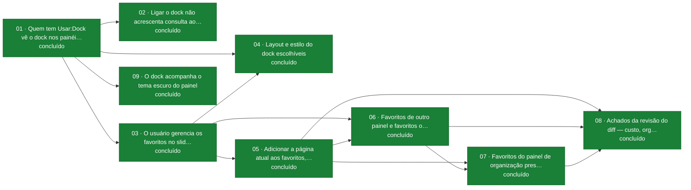

# Quadro dos tickets — `dock-de-acoes-rapidas`

> **Gerado** por `scripts/indice.sh` da skill `feature-tickets`, a partir dos arquivos desta pasta.
> **Não editar à mão**: rodar o script de novo — inclusive para resolver conflito de merge. O
> script lê arquivos, não roda testes: CT verdes são inferidos do `Status` (`em revisão` e
> `concluído` = todos verdes, `pronto` = nenhum), e ticket `em execução` mostra `—`.

**Branch**: `main` · **Wiki**: [`03-progresso.md`](../03-progresso.md) · **Todas as features**: [`INDEX.md`](../../../INDEX.md)

## Progresso

`[████████████████████] 100 %` — 9 de 9 tickets concluídos

| pronto | em execução | em revisão | concluído |
|---|---|---|---|
| 0 | 0 | 0 | 9 |

**Fronteira** (pode ser pego agora): todos concluídos · **CT verdes** (inferidos do `Status`): 77 de 77

## Tickets

| NN | Entrega | Status | CT verdes | Bloqueado por |
|---|---|---|---|---|
| [01](01-dock-aparece-por-painel-e-permissao.md) | Quem tem Usar:Dock vê o dock nos painéis ligados | concluído | 13/13 | — |
| [02](02-dock-sem-consulta-extra-ao-banco.md) | Ligar o dock não acrescenta consulta ao banco | concluído | 4/4 | 01 |
| [03](03-usuario-gerencia-favoritos-no-slideover.md) | O usuário gerencia os favoritos no slideover | concluído | 12/12 | 01 |
| [04](04-layout-e-estilo-do-dock.md) | Layout e estilo do dock escolhíveis | concluído | 6/6 | 01, 03 |
| [05](05-adicionar-esta-pagina-com-teto.md) | Adicionar a página atual aos favoritos, até 10 | concluído | 9/9 | 03 |
| [06](06-favoritos-entre-paineis-e-ocultos.md) | Favoritos de outro painel e favoritos ocultos | concluído | 12/12 | 03, 05 |
| [07](07-favoritos-presos-a-organizacao.md) | Favoritos do painel de organização presos à organização | concluído | 15/15 | 05, 06 |
| [08](08-achados-da-revisao-do-diff.md) | Achados da revisão do diff — custo, organização excluída e aviso | concluído | 5/5 | 05, 06, 07 |
| [09](09-dock-no-tema-escuro.md) | O dock acompanha o tema escuro do painel | concluído | 1/1 | 01 |

## Dependências

Seta = "bloqueia". Cor e segunda linha de cada nó = status: verde concluído · roxo em revisão ·
âmbar em execução · azul pronto na fronteira · cinza pronto aguardando bloqueio · vermelho pergunta
ao solicitante aberta (seta pontilhada).

